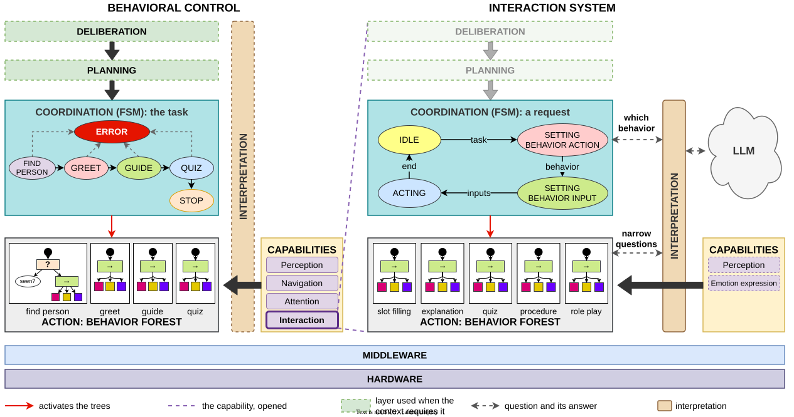
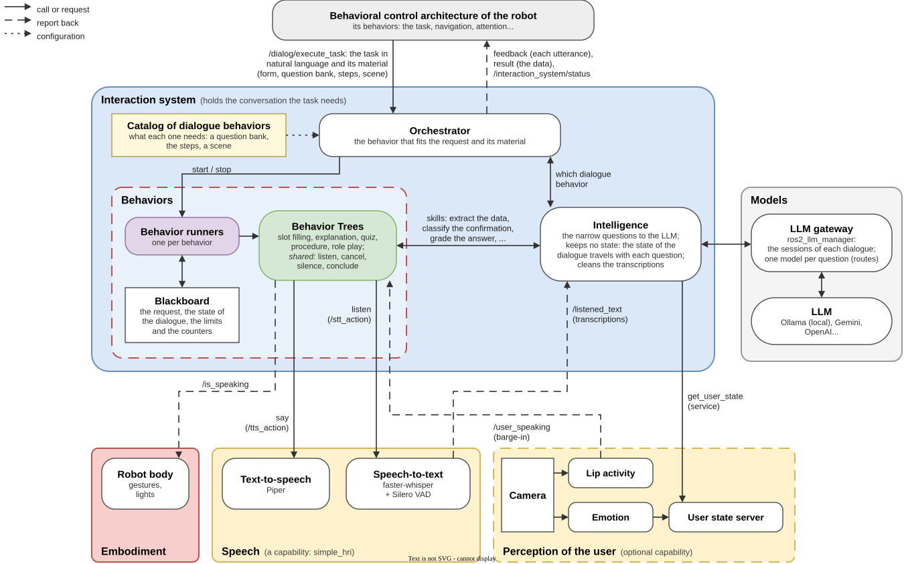
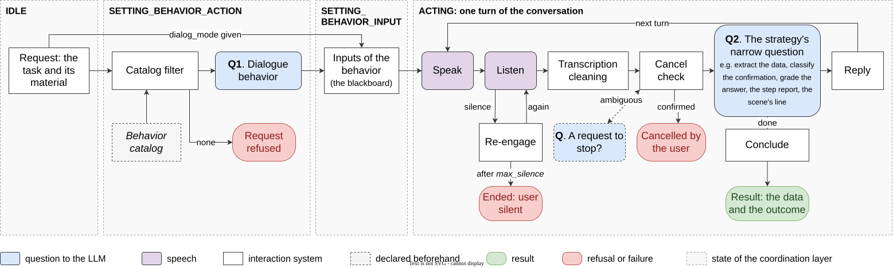

# interaction_system


An autonomous spoken interaction system for social robots, built on ROS 2 Jazzy (and on ROS 2
Lyrical with pixi).

A social robot in a home, a care facility or a classroom holds conversations with a purpose: it
takes an order, registers a patient, explains the instructions before a test and checks that they
were understood, runs a memory quiz, guides an exercise step by step, or plays an interviewer so
that the user can practice. In this system, robot behaviors request a conversation by describing
its task in natural language, and get the result back as structured data. The interaction system
chooses how to hold the conversation, holds it by voice, and keeps it on track when the user goes
off topic, falls silent, interrupts or wants to stop. A large language model (LLM) understands the
user and phrases the robot's replies, but never decides what happens next.

The sections below explain the idea and the design decisions behind it, the architecture the
system belongs to, and how it processes a request. The [evaluation](#running-the-experiments)
contains the experiments that test each decision, so that anyone can run them again.

A request is a goal of one ROS 2 action. For example, this one starts a conversation that takes a
coffee order:

```sh
ros2 action send_goal --feedback /dialog/execute_task ros2_dialog_interfaces/action/DialogTask \
  "{task_description: 'Take a coffee order: drink type, size and customer name', domain: 'coffee shop'}"
```

## The idea

The system rests on five design decisions.

1. The task frame bounds the LLM. Every conversation is organized around a frame: the structured
   list of what the conversation must cover, with the state of each element. Depending on the
   task, the elements are the fields of a form, the key points of an explanation, the questions
   of a quiz, the steps of a procedure, the items of a questionnaire or the criteria of a
   role-play rubric. The requesting behavior sends the frame, or the material to build it from,
   and gets it back filled. The frame is kept outside the LLM. Each question to the LLM concerns
   one element, each answer is validated against the frame before it is accepted, each reply is
   phrased for the element that the tree chose, and the LLM never decides that an element is
   done. Frames are as old as dialogue systems (form filling); here they are the contract that
   governs a generative model ([the frame of the task](docs/ARCHITECTURE.md#the-frame-of-the-task)).
2. Control is deterministic and understanding is probabilistic. The phases of a conversation,
   the turn limits, the confirmation of the collected data and cancellation are explicit control.
   The LLM is only asked to answer narrow questions with a JSON schema (which slots does this
   utterance fill? is it a confirmation or a correction?) or to phrase one utterance. Every call
   has a timeout, bounded retries and a deterministic fallback, so a misbehaving LLM degrades the
   conversation but never derails it.
3. Each dialogue behavior is a Behavior Tree. The dialogue behaviors (the dialogue strategies) are
   slot filling, explanation with a teach-back check of understanding, quiz, guided procedure,
   role play, grounded question answering and standardized questionnaire. The trees share the
   subtrees that keep any conversation on track ([the shared mechanisms](#the-dialogue-behaviors)).
   Every conversation ends with a closing line and an outcome with its reason, so the requesting
   behavior knows why it ended and can act on it. A new dialogue behavior is a new tree and its
   questions, not a change to the system.
4. The dialogue behavior is chosen from the task. A request can name its dialogue behavior, or
   the system chooses one. A dialogue behavior is offered only if the request provides what it
   needs (a quiz needs a question bank, a procedure its steps, a role play its scene), and the LLM
   chooses among the offered ones from their descriptions.
5. Dialogue is a robot capability. The interaction system has the same layers as the robot's
   behavioral control architecture: a finite state machine (FSM) coordinates each request and
   activates the tree of the chosen dialogue behavior. The rest of the robot sees one action and
   one status topic. Interpretation, beside the layers, answers the narrow questions they ask; it
   commands nothing. Speech (a sub-capability that the trees call), user perception and the LLM
   (an external service) are separate from the interaction system, and each can be replaced.

The interaction system only holds the conversation. Other robot capabilities move, point or
gesture; the embodiment layer (e.g. the NAO's gestures and eye LEDs) follows the generic signals
that the conversation publishes.

## Interaction as a robot capability



The robot is controlled by a layered behavioral control architecture (left), built with
[`behavior_architecture`](https://github.com/geriabot/behavior_architecture): an FSM coordinates
the task plan and activates, phase by phase, a *behavior forest* of Behavior Trees. The robot's
capabilities (perception, navigation, attention, interaction) are autonomous subsystems with a
standard interface. The interaction system (right) is one of them, and has the same layers
inside:

| Layer | In the robot's architecture | In the interaction system |
|---|---|---|
| Deliberation, planning | Decide the goals, when needed | Not needed: the goal comes in the request |
| Coordination | An FSM, the task plan | An FSM, the life of a request: `IDLE`, `SETTING_BEHAVIOR_ACTION`, `SETTING_BEHAVIOR_INPUT`, `ACTING` |
| Action | The behavior forest | One tree per dialogue behavior; only the chosen one is active |
| Interpretation (beside the layers) | Optional, consulted by any layer | Consulted by the FSM (which dialogue behavior) and by the trees (understanding, phrasing); it asks the LLM and controls nothing |
| Capabilities | Perception, navigation, attention, interaction... | User perception (lip activity for barge-in, experimental; emotion, preliminary) and, planned, emotion expression; speaking and listening go through speech (simple_hri), a low-level sub-capability that the trees call |
| External service | — | The LLM, behind interpretation; it can be replaced |

Beside the layers, and outside their chain of control, is **interpretation**. It turns what
arrives without structure (the request in natural language, a line of the user) into a validated
answer to a narrow question that a layer asks: which dialogue behavior fits the request, which
values of the form a line gives, whether a line asks to stop. It commands nothing and keeps no
state; what to do with each answer is always decided by the coordination or the action layer.
Behind it is the LLM, which can be replaced.
[ARCHITECTURE.md](docs/ARCHITECTURE.md#interaction-as-a-capability-with-the-robots-layers-inside)
explains why interpretation is neither a layer nor a capability.

The next figure shows the nodes of the interaction system and, around them, the behavioral
control architecture, speech, user perception, the embodiment and the models:



For the rest of the robot, the interaction system is one more capability. `mission_executor`
configures and activates it through the lifecycle of `/interaction_orchestrator`. The system
receives the task as the goal of an action, reports every utterance as feedback, and returns the
result of the conversation ([Using it from robot behaviors](#using-it-from-robot-behaviors)).
The LLM is served by Ollama, locally or on a GPU server, or by a cloud provider
([MODELS.md](docs/MODELS.md)). [ARCHITECTURE.md](docs/ARCHITECTURE.md) explains the design and
the reasons for it.

## How a request is processed



The figure follows one request, and one user turn of the conversation that it starts. The columns
are the states of the FSM. Question 1 chooses the dialogue behavior when the request does not name
it and more than one fits; question 2 is the narrow question that the dialogue behavior asks on
each turn.

1. Request. A robot behavior sends a `DialogTask` goal to `/dialog/execute_task` with the task.
   The goal can also carry the dialogue behavior (`dialog_mode`), a slot schema, values to resume
   from, resources (a question bank, the steps, a scene, reference text), a domain and the limits
   of the conversation (turns, seconds of silence, turns without progress). One conversation runs
   at a time; another request is rejected while one runs.
2. Choice of the dialogue behavior. If the request names it, it is used. Otherwise the
   intelligence offers the dialogue behaviors whose needs the request provides and, if there is
   more than one, the LLM chooses.
3. Request to the blackboard. The FSM writes the request, the limits and the counters to the
   blackboard of the behaviors and activates the tree of the dialogue behavior.
4. Conversation. The tree opens the conversation (`begin` builds the dialogue state from the
   request), then runs one user turn per cycle: check the turn limit, listen, check for a spoken
   cancellation, let the dialogue behavior handle the turn, and speak the reply. Each step that
   needs language asks the intelligence one *skill*. The dialogue state travels with each skill
   and back to the blackboard, so the intelligence keeps no state.
5. Feedback. Every utterance is reported in the action's feedback before it is spoken.
6. Result. When the tree ends, the FSM returns the result and the intelligence closes the
   dialogue (its LLM sessions and its transcript). `/interaction_system/status` shows `IDLE`
   again, or `FAILED` if the conversation did not achieve its goal.

## The dialogue behaviors

The catalog is in `interaction_system_core/interaction_system/config/interaction_orchestrator_params.yaml`
and the trees are in `interaction_system_behaviors/behavior_tree_xml`.

| Dialogue behavior (`dialog_mode`) | The robot... | Needs from the request | Returns |
|---|---|---|---|
| `slot_filling` | Asks for the data it needs, accepts corrections, validates types, allowed values, ranges and conditions, then reads the data back for confirmation | Nothing (the schema is optional) | The frame as JSON |
| `explanation` | Explains a topic, checks with teach-back that it was understood, and answers questions | Nothing (reference text and key points are optional) | The status of each key point |
| `quiz` | Asks the questions of a bank, grades each spoken answer and gives the score | A question bank | The result of each question |
| `procedure` | Guides through steps, helps when the user is stuck, and repeats, goes back or skips on request | The steps | The outcome of each step |
| `roleplay` | Plays a character in a scene, gives hints on request, then scores the user on each criterion of a rubric (1 to 5) | The scene and its rubric | The scores and the feedback |
| `grounded_qa` | Answers the user's questions only from the given information, verifying each answer against it | The material (plain text) | Each question with its resolution |
| `questionnaire` | Reads a standardized questionnaire word for word, maps each answer to an option of the scale and computes the score | The instrument | The answer to each item and the score |

Without a slot schema, the LLM designs one from the task. In teach-back, the user explains the
topic back in their own words; each key point is checked, and only what is missing or wrong is
explained again. A user who does not want to restate it gets a direct question instead. In
grounded question answering, the robot says when it does not have the information and declines
what is outside the task. In the questionnaire, the robot never chooses an option for the user and
never says the score.

All dialogue behaviors share the following mechanisms. The trees drive them with counters; the
LLM only classifies the turn.

| Mechanism | What the robot does |
|---|---|
| [Silence](docs/behaviors/silence.md) | Says that it is waiting and repeats what it asked; it closes only after `max_silence` seconds (90 by default). A procedure step may declare how long it takes |
| [Spoken cancellation](docs/behaviors/cancellation.md) | On "stop, forget it", asks for confirmation; only a yes ends the conversation, and any other answer resumes with what it had asked |
| [Recovery and communication breakdown](docs/behaviors/no_progress.md) | Repeats an element that the user cannot answer, simplifies it, then leaves it unanswered; after `max_stalled` turns in a row without progress (4 by default), it closes |
| [Endings](docs/behaviors/endings.md) | Never ends a conversation silently: every ending has a closing line, and the result says how and why the conversation ended |
| [Conversational fillers](docs/behaviors/fillers.md) | Precedes a reply that is not ready within two seconds with a fixed filler ("Hmm…"), whose wording changes as the wait grows; a filler is not a turn and changes no counter |
| [Barge-in](docs/behaviors/barge_in.md) *(experimental)* | Stops speaking and listens when the user interrupts it. Implemented, not validated |

Barge-in uses the lip activity that user perception provides; without it, the robot finishes
each utterance.

The result's `outcome` is one of `completed` (the only success), `partial`, `failed`,
`cancelled`, `user_silent`, `breakdown`, `turn_limit` and `error`, and `failure_reason` says why.
`partial` means that the conversation ended normally with an element left unfinished: an
unanswered slot or question, or a skipped or stuck step. Each dialogue behavior and mechanism is
described in detail, with its Behavior Tree, in [docs/behaviors](docs/behaviors/README.md).

## Using it from robot behaviors

The rest of the robot sees one action and one topic. [INTEGRATING.md](docs/INTEGRATING.md)
explains the integration step by step, and [ROS_INTERFACES.md](docs/ROS_INTERFACES.md) lists
every interface.

| | Interface | Content |
|---|---|---|
| In | `/dialog/execute_task` (action `ros2_dialog_interfaces/action/DialogTask`) | `task_description`: the task in natural language. The optional fields are listed below |
| Out | feedback | `state` (the phase), `current_frame_json` (the data so far), `last_utterance`, `turns` |
| Out | result | `success` (only when `outcome` is `completed`), `outcome` (how it ended), `final_frame_json` (the data, also when it did not complete), `failure_reason` (why), `total_turns` |
| Out | `/interaction_system/status` | `IDLE` (0), `REASONING` (1), `RUNNING` (2), `FAILED` (3), with the running dialogue behavior and its phase |

The optional fields of the goal are `dialog_mode`, `frame_schema_json`
([format](docs/SLOT_SCHEMA.md)), `initial_frame_json` (to resume), `resources_json`, `domain`,
`skip_intro` (for chained conversations), and the limits and settings of the shared mechanisms
(`max_turns`, `max_silence`, `max_stalled` and the others listed in
[ROS_INTERFACES.md](docs/ROS_INTERFACES.md#dialogtask-goal)). A limit left unset takes the
system's value.

From a robot's Behavior Tree, the `ExecuteDialog` node of
[`dialostack_bt_client`](dialostack_bt_client/README.md) sends the goal and writes its result to
the tree's blackboard.
[INTEGRATING.md](docs/INTEGRATING.md#goals-for-every-dialogue-behavior) has example goals for
every dialogue behavior. The interaction system has no code for a particular robot;
what a robot provides (speech, embodiment, user perception) is described in
[ADDING_A_ROBOT.md](docs/ADDING_A_ROBOT.md).

## Languages

The system speaks English and Spanish, selected with the parameter `language` or the launch
argument (`main.launch.py language:=es`). The method does not depend on the language: the code
decides what the conversation does, and the LLM answers narrow questions in the language of the
conversation. Everything that depends on the language is in one file per language,
`interaction_system_core/interaction_intelligence/config/languages/<language>.yaml`. The file
holds the fixed phrases (what the robot says when the LLM fails, the silence prompts, the
closings), the acknowledgments and fillers, the exact stop commands ("stop"; "para"), the yes/no
words, the noise phrases of the recognizer, and the recognition language and voice of
simple_hri. The prompts are a single English set that asks for the replies in the language of the
conversation.

Adding a language means writing its file (a translated copy of `english.yaml`; the loader and the
tests check that it has every key and placeholder), choosing a voice, and checking the result.
[ADDING_A_LANGUAGE.md](docs/ADDING_A_LANGUAGE.md) gives the steps, including what the evaluation
needs to evaluate the new language. The evaluation validates the method in English in
simulation; the study with real users is in Spanish
([evaluation/doc/EXPERIMENTS.md](evaluation/doc/EXPERIMENTS.md)).

## Documentation

Read the guides in this order to go from what the system does to how to extend it.

1. [INDEX.md](INDEX.md): every command on one page.
2. [ARCHITECTURE.md](docs/ARCHITECTURE.md): the design (an FSM that coordinates a forest of
   Behavior Trees, and an intelligence that asks the LLM), the nodes, a request node by node, and
   the configuration files.
3. [docs/behaviors](docs/behaviors/README.md): each dialogue behavior and shared mechanism in
   detail, with a drawing of its Behavior Tree.
4. [SPEECH.md](docs/SPEECH.md): the speech sub-capability (simple_hri), how the trees listen and
   speak, and barge-in (experimental).
5. [MODELS.md](docs/MODELS.md): which model answers each question, and how to change it.
6. [PROMPTS.md](docs/PROMPTS.md): the questions to the LLM, which skill asks each one, and how to
   change them.
7. [INTEGRATING.md](docs/INTEGRATING.md): using the interaction system from your robot's software.
8. [ADDING_A_ROBOT.md](docs/ADDING_A_ROBOT.md): what a robot provides, with the NAO as the example.
9. [ADDING_DIALOGUE_BEHAVIORS.md](docs/ADDING_DIALOGUE_BEHAVIORS.md): adding a new dialogue
   behavior.
10. [ADDING_A_LANGUAGE.md](docs/ADDING_A_LANGUAGE.md): adding a language (the language files).
11. [evaluation/README.md](evaluation/README.md) and
    [evaluation/doc/EXPERIMENTS.md](evaluation/doc/EXPERIMENTS.md): the evaluation tools and the
    experiments ([Running the experiments](#running-the-experiments)).
    [evaluation/HUMAN_REVIEW.md](evaluation/HUMAN_REVIEW.md) has the instructions for the people
    who review and annotate.

Reference pages:

- [INSTALLATION.md](docs/INSTALLATION.md): the two ways to install, with
  [pixi](docs/INSTALL_PIXI.md) (recommended) or [natively](docs/INSTALL_NATIVE.md) (system ROS 2).
- [PIXI.md](docs/PIXI.md): the pixi environment, adding a package, ROS 2 Lyrical.
- [GPU_SERVER.md](docs/GPU_SERVER.md): serving the models from a shared GPU server, without `sudo`.
- [CONFIGURATION.md](docs/CONFIGURATION.md): every parameter of every node.
- [SLOT_SCHEMA.md](docs/SLOT_SCHEMA.md): the slot schema (types, allowed values, ranges,
  conditional slots).
- [ROS_INTERFACES.md](docs/ROS_INTERFACES.md) and [LAUNCH_ARGUMENTS.md](docs/LAUNCH_ARGUMENTS.md):
  every node, topic, service, action and launch argument.
- [VALIDATION_AND_TROUBLESHOOTING.md](docs/VALIDATION_AND_TROUBLESHOOTING.md): checks and common
  problems.
- Packages: [interaction_perception](interaction_perception/interaction_perception/README.md),
  [ros2_llm_manager](ros2_llm_manager/README.md),
  [dialostack_bt_client](dialostack_bt_client/README.md), [robots/nao](robots/nao/README.md),
  [the web GUI](dialostack_gui/src/README.md).

## Repository structure

<details>
<summary>Show repository structure</summary>

| Package | Description |
|---|---|
| `interaction_system_core/interaction_system` | The orchestrator (the FSM of a request, a `behavior_architecture` plugin), the catalog of dialogue behaviors, the configuration and the launch files |
| `interaction_system_core/interaction_system_interfaces` | Status, and the requests that the orchestrator and the trees send to the intelligence |
| `interaction_system_core/interaction_intelligence` | The interaction intelligence: the skills (the questions to the LLM), the dialogue frame, the prompts |
| `interaction_system_behaviors` | The Behavior Trees of the dialogue behaviors (XML) and their nodes (`AskIntelligence`, `Speak`, `Listen`, `WithFillers`) |
| `ros2_dialog_interfaces` | The public interface: the `DialogTask` action and the `BargeIn` message |
| `ros2_llm_manager`, `ros2_llm_interfaces` | The LLM gateway: one inference action and session services for Ollama and cloud providers |
| `interaction_perception/*` | User perception: lip activity (barge-in, experimental), facial emotion (preliminary, not validated), and the user-state service |
| `dialostack_gui` | Web GUI to configure, launch and monitor conversations |
| `dialostack_bt_client` | BehaviorTree.CPP node that runs a conversation as a step of a robot's tree |
| `robots/nao` | NAO embodiment: URDF, talking gestures, eye LEDs, pose tooling |
| `evaluation/*` | Offline benchmarks, the simulation (simulated users and speech), ablations, experiments and analysis ([README](evaluation/README.md)) |

The root of the repository also contains:

- `thirdparty.repos`: the source dependencies, `behavior_architecture` (only its base, without
  its optional LLM orchestrators) and `simple_hri`;
- `pixi.toml` and `pixi.lock`: the environments, which `pixi/setup_workspace.sh` links at the root
  of the workspace;
- `requirements.txt`: the Python packages of the native installation, and `activate.sh`, which
  prepares a terminal with system ROS and a Python virtual environment
  ([INSTALL_NATIVE.md](docs/INSTALL_NATIVE.md));
- `gui.sh`: starts the web GUI.

</details>

## Usage

The system is a ROS 2 Jazzy workspace (ROS 2 Lyrical with pixi). Below, `<workspace>` is the
colcon workspace (e.g. `~/interaction_ws`).

### Requirements

- An x86-64 PC with Linux: any distribution with pixi, or Ubuntu 24.04 with system ROS 2 Jazzy.
- An LLM served by [Ollama](https://ollama.com), on this computer or on a GPU server
  ([GPU_SERVER.md](docs/GPU_SERVER.md)). The default model, `qwen2.5:7b`, needs a GPU with about
  8 GB; the experiments use open models that fit a GPU with 24 GB. A cloud provider can be used
  instead ([MODELS.md](docs/MODELS.md)).
- A microphone and a speaker.
- About 8 GB of disk for the pixi environment (about 3.5 GB more for the optional Lyrical one),
  and Internet access on the first run, which downloads the environment and the speech models.

### Installation

With pixi ([INSTALL_PIXI.md](docs/INSTALL_PIXI.md) has the details, ROS 2 Lyrical and the
optional parts):

```sh
curl -fsSL https://pixi.sh/install.sh | sh          # once; then open a new terminal
pixi global install vcstool                         # once

mkdir -p <workspace>/src && cd <workspace>/src
git clone --recurse-submodules https://github.com/geriabot/interaction_system.git
vcs import . < interaction_system/thirdparty.repos  # behavior_architecture and simple_hri
cd ..
./src/interaction_system/pixi/setup_workspace.sh    # once: links pixi.toml and pixi.lock here
pixi run build
```

`--recurse-submodules` also fetches the evaluation; without access to it,
[INSTALL_PIXI.md](docs/INSTALL_PIXI.md#install-and-build) explains how to build.

Then, in every terminal where you run the system:

```sh
cd <workspace>
pixi shell
source install/setup.bash
```

Run pixi from `<workspace>`, not from inside the repository
([PIXI.md](docs/PIXI.md#where-it-lives)). To use a system ROS 2 Jazzy instead of pixi, see
[INSTALL_NATIVE.md](docs/INSTALL_NATIVE.md).

### Quick start

1. Serve the LLM so that Ollama answers at `localhost:11434`: install
   [Ollama](https://ollama.com/download) on this computer, or open a tunnel to a GPU server that
   runs it ([GPU_SERVER.md](docs/GPU_SERVER.md)). Then pull the default model:
   ```sh
   ollama pull qwen2.5:7b
   ```
2. In a prepared terminal, start the whole stack (speech with simple_hri, the LLM gateway and the
   interaction system). The first run downloads the speech models into `models/` of the current
   directory:
   ```sh
   ros2 launch interaction_system main.launch.py            # language:=es for Spanish
   ```
3. In another prepared terminal, request a conversation and speak to the robot:
   ```sh
   ros2 action send_goal --feedback /dialog/execute_task ros2_dialog_interfaces/action/DialogTask \
     "{task_description: 'Take a coffee order: drink type, size and customer name', dialog_mode: slot_filling}"
   ```

The robot greets the user, asks for each missing piece of data, handles corrections ("actually,
make it a large"), reads the order back and returns it in `final_frame_json`. The feedback shows
every utterance; `ros2 topic echo /interaction_system/status` shows the state of the system.

### Running the system

| What | Command |
|---|---|
| The whole stack | `ros2 launch interaction_system main.launch.py [speech:=simple_hri\|none] [stt:=faster_whisper\|whisper] [tts:=piper\|mms] [language:=en\|es]` ([languages](#languages)) |
| Only the interaction system (speech and LLM started separately) | `ros2 launch interaction_system interaction_system.launch.py` |
| The LLM gateway alone | `ros2 launch ros2_llm_manager llm_manager.launch.py` |
| User perception (optional) | `ros2 launch interaction_perception interaction_perception.launch.py image_topic:=<camera>` |
| The web GUI | `./src/interaction_system/gui.sh`, then open <http://localhost:5173> ([INSTALLATION.md](docs/INSTALLATION.md#the-web-gui)) |

`speech:=none` starts no speech nodes, for the simulation or for a robot that serves the speech
actions itself ([SPEECH.md](docs/SPEECH.md#using-your-robots-own-speech)). Every launch argument is
in [LAUNCH_ARGUMENTS.md](docs/LAUNCH_ARGUMENTS.md), every parameter in
[CONFIGURATION.md](docs/CONFIGURATION.md), and every command in [INDEX.md](INDEX.md).

### Tests

```sh
pixi run test     # unit tests of the intelligence (no ROS)
# whole conversations through the running system, with a scripted LLM (no model, no audio);
# in a prepared terminal, with a ROS_DOMAIN_ID that nothing else uses
ROS_DOMAIN_ID=77 python -m pytest src/interaction_system/evaluation/simulation/interaction_sim/test
cd src/interaction_system/dialostack_gui && npm ci && npm test   # GUI logic (npm ci once)
```

## Running the experiments

The experiments run the system against simulated users (local or cloud models) with ground
truth, and with real participants; the scripts score the conversations. The scenarios, the
experiment files and the tools (not the results) are in `evaluation/`, a git submodule that stays
private until the work is published; until then, the links into `evaluation/` in this
documentation open only with access to it.

The simplest way is the web control panel. It runs an experiment on a hardware profile (a
*campaign*), first checking that the GPU servers are free, and shows its progress. It can also run
a single dialogue of an experiment or the quick checks, and it runs the sessions with real
participants, in campaigns that each freeze how the robot sounds. Its Tests tab lets you play the
user of any scenario yourself, by voice, without storing anything:

```sh
cd <workspace>/src/interaction_system
python3 evaluation/scripts/control_panel.py      # then open http://localhost:8095 (#tests: the Tests tab)
```

The same from a prepared terminal:

```sh
cd <workspace>/src/interaction_system/evaluation
ROS_DOMAIN_ID=<free id> python scripts/sim_checks.py start                    # quick check, no model
python scripts/run_experiment.py experiments/<experiment>.yaml --dry-run      # list the dialogues
python scripts/run_parallel.py experiments/<experiment>.yaml experiments/hardware/<profile>.yaml   # run it
python analysis/score_runs.py results/<name>                                  # score them
```

These commands need the workspace built with pixi and the models answering (Ollama at
`localhost:11434`). Cloud models are paid, so every command that would call one needs
`--allow-cloud`. The guides are [the control panel](evaluation/doc/CONTROL_PANEL.md),
[the tools](evaluation/README.md) and [the experiments](evaluation/doc/EXPERIMENTS.md).

## Troubleshooting

- `pixi` cannot find a manifest: run it from the root of the workspace, after running
  `./src/interaction_system/pixi/setup_workspace.sh` once.
- pixi starts downloading a second environment, or warns `Could not find activation scripts`: it
  was run inside `src/interaction_system` or with `--manifest-path`; run it from the root of the
  workspace ([PIXI.md](docs/PIXI.md#where-it-lives)).
- A second request is rejected: only one conversation runs at a time, so cancel the running goal
  first.
- The robot does not answer: check that Ollama answers (`curl -s localhost:11434/api/version`) and
  that the model in `app_params.yaml` is pulled ([MODELS.md](docs/MODELS.md#the-local-model)).

[VALIDATION_AND_TROUBLESHOOTING.md](docs/VALIDATION_AND_TROUBLESHOOTING.md) has more checks and
runtime problems.

## Credits

This system started as a final degree thesis (TFG) at Universidad Rey Juan Carlos, supervised
by Rodrigo Pérez-Rodríguez and Juan Diego Peña Narváez and carried out by Álvaro Quintana Camacho:
[*Sistema Inteligente de Interacción Autónoma Persona-Robot*](https://burjcdigital.urjc.es/items/4d0ae885-da6c-4f7f-8d03-08067adf94f5)
(2026). The code of the thesis, as it was delivered (DialoStack), is in
[aquintan4/DialoStack](https://github.com/aquintan4/DialoStack).

## License

This project is licensed under the MIT License (see the [LICENSE](./LICENSE) file). The vendored
`robots/nao/nao_description/` (NAO URDF) is third-party software under Apache-2.0 and BSD, with
its own `LICENSE` and `NOTICE`.
