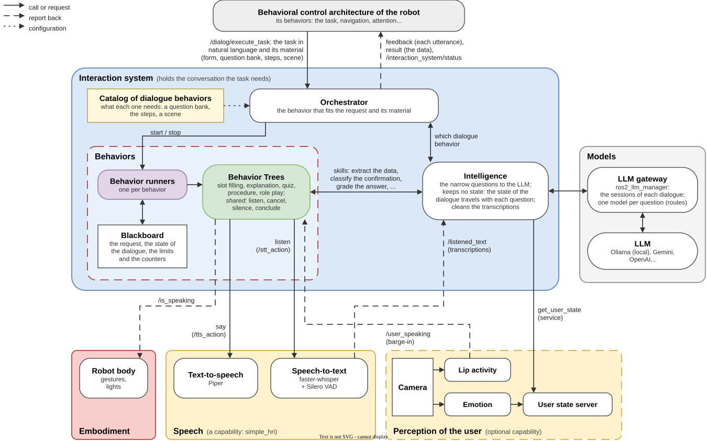

# Adding a robot

The interaction system has no code for any particular robot. It needs a way to listen and to
speak, and the rest of the robot needs a way to ask it for a conversation. Everything else (the
gestures, the lights, user perception) is optional and follows generic signals. This
page lists what a robot must or may provide, with the NAO of `robots/nao` as the worked example.
How the robot's software asks for a conversation is in [INTEGRATING.md](INTEGRATING.md).



## What a robot provides

| What | Needed | Through | Where it is explained |
|---|---|---|---|
| Speech: listening and speaking | Yes | simple_hri on a computer with a microphone and a speaker, or the robot's own speech serving the same actions | [Speech](#speech) |
| A behavior that asks for conversations | Yes | A goal to `/dialog/execute_task`, from a Behavior Tree (`ExecuteDialog`) or any node | [INTEGRATING.md](INTEGRATING.md) |
| Embodiment: gestures, lights | No | Robot nodes that follow `/is_speaking` and the other signals of the conversation | [Embodiment](#embodiment) |
| User perception | No | A camera for `interaction_perception`, or the robot's own detector publishing `/user_speaking` | [User perception](#user-perception) |
| An LLM | Yes | Ollama on the robot's computer or on a GPU server; not part of the robot | [MODELS.md](MODELS.md) |

The robot's software and the interaction system talk over ROS 2, so they run on the same ROS
domain (`ROS_DOMAIN_ID`).

## Speech

The trees listen and speak through two actions ([SPEECH.md](SPEECH.md)):

| Name | Type | What the robot's side does |
|---|---|---|
| `/stt_action` | `simple_hri_interfaces/action/Listen` (`max_wait` → `success`, `timed_out`, `text`) | Waits for the user, records until silence and returns the transcription |
| `/tts_action` | `simple_hri_interfaces/action/Say` (`text` → `success`) | Says the text and finishes when the playback ends |
| `/listened_text` | `std_msgs/String` | Publishes every transcription, which the intelligence reads (`transcription_topics`) |

There are two ways to provide them:

- **simple_hri**, started by `main.launch.py`. It uses the microphone and the speaker of the
  computer that runs it; simple_hri can also forward the synthesized audio to another machine.
  This is the default and needs nothing from the robot.
- **The robot's own speech.** Start the interaction system with `main.launch.py speech:=none`
  and serve the two actions and the topic from the robot's speech software
  ([SPEECH.md](SPEECH.md#using-your-robots-own-speech)). The simulation of the evaluation does
  exactly this.

## Embodiment

The interaction system publishes generic signals that the robot's nodes can follow
([ROS_INTERFACES.md](ROS_INTERFACES.md#the-public-interface)):

| Signal | Type | Use |
|---|---|---|
| `/is_speaking` | `std_msgs/Bool` (transient local) | True while the robot speaks, whatever the speech capability: talking gestures, mouth or eye lights |
| `/robot_utterance` | `std_msgs/String` | Each line of the robot, when it starts to be said |
| `/robot_filler` | `std_msgs/String` | Each conversational filler ("Hmm…", said while the reply is prepared), when it starts to be said: e.g. a thinking gesture |
| `/interaction_system/status` | `interaction_system_interfaces/msg/InteractionSystemStatus` | The state of the system and the phase of the conversation: an idle pose, a listening light |
| `/barge_in` | `ros2_dialog_interfaces/msg/BargeIn` | The user cut the robot off (experimental, not validated) |

`/is_speaking` is published by the `Speak` and `WithFillers` nodes of the trees, not by the speech package, so an
embodiment written for it works with simple_hri and with the robot's own speech alike.

## User perception

Optional. It gives the visual barge-in (experimental, not validated) and the emotion of the user
(preliminary, off by default;
[interaction_perception](../interaction_perception/interaction_perception/README.md)):

- With `interaction_perception`: pass the robot's camera topic,
  `ros2 launch interaction_perception interaction_perception.launch.py image_topic:=<camera topic>`.
- With the robot's own detector: publish `/user_speaking` (`std_msgs/Bool`, true while the user
  speaks), the topic `Speak` reads (`user_speaking_topic` of `interaction_orchestrator`,
  [CONFIGURATION.md](CONFIGURATION.md#interaction_orchestrator)).

Without either, the robot finishes each utterance before it listens.

## The worked example: NAO

`robots/nao` is the embodiment of the SoftBank NAO ([README](../robots/nao/README.md)). It is
a consumer of the signals above; the interaction system does not depend on it.

| What | How the NAO provides it |
|---|---|
| Speech | simple_hri on the computer next to the robot (its microphone and speaker), or with the synthesized audio forwarded |
| Embodiment | `nao_pose_manager`: `arm_gesture_manager` (talking gestures and idle poses) and `eye_led_feedback` (the color of the eye LEDs), described below |
| User perception | `interaction_perception`, with a camera |
| The behaviors | Any behavior of the robot's architecture, with `ExecuteDialog` ([dialostack_bt_client](../dialostack_bt_client/README.md)) |

In `nao_pose_manager`, `arm_gesture_manager` moves the arms with talking gestures and idle poses
while `/is_speaking` is true, and `eye_led_feedback` sets the color of the eye LEDs from
`/is_speaking` (and from `/user_vad` if something publishes it). Both command the robot through
the `nao_lola` effector topics.

The NAO packages are not in the `build` task of pixi. Build them, then start the gestures and the
LEDs next to the interaction system (they need `nao_lola` running on the robot):

```sh
colcon build --symlink-install --packages-select nao_description nao_pose_manager
ros2 launch nao_pose_manager arm_gesture_manager.launch.py
```

Their parameters are in [CONFIGURATION.md](CONFIGURATION.md#arm_gesture_manager), and the
simulation in RViz in the [NAO README](../robots/nao/README.md#usage).

## A new robot, step by step

1. Choose the speech: simple_hri on a computer with a microphone and a speaker near the user, or
   the robot's speech serving `/stt_action`, `/tts_action` and `/listened_text`.
2. Start the stack (`main.launch.py`, with `speech:=none` for the robot's own speech) and check
   the speech alone ([SPEECH.md](SPEECH.md#testing-the-speech-alone)).
3. Ask for a conversation from a terminal ([INTEGRATING.md](INTEGRATING.md#goals-for-every-strategy)),
   then from the robot's behaviors ([INTEGRATING.md](INTEGRATING.md#from-a-behavior-tree-of-the-robot)).
4. Optionally, write the embodiment: a node that subscribes to `/is_speaking` (and
   `/interaction_system/status`) and drives the robot's gestures or lights, as
   `nao_pose_manager` does.
5. Optionally, add user perception for the visual barge-in.
