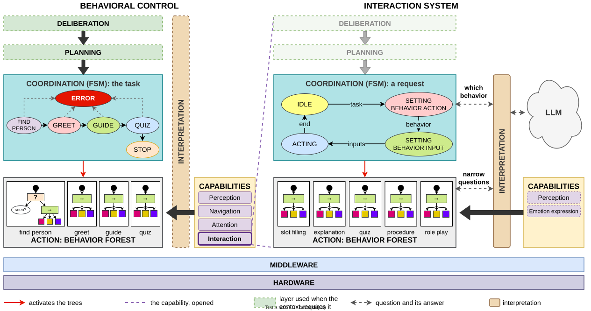
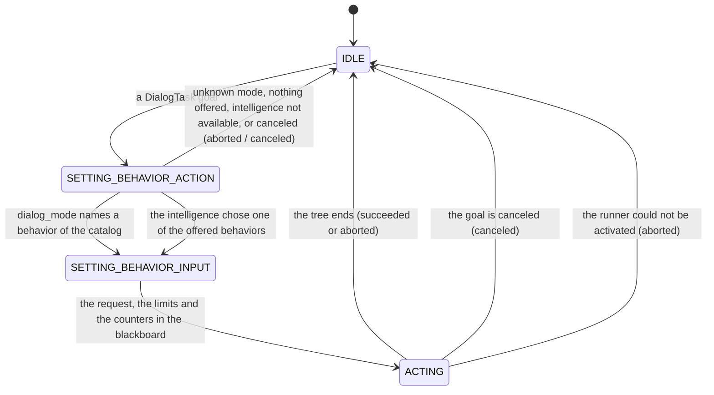
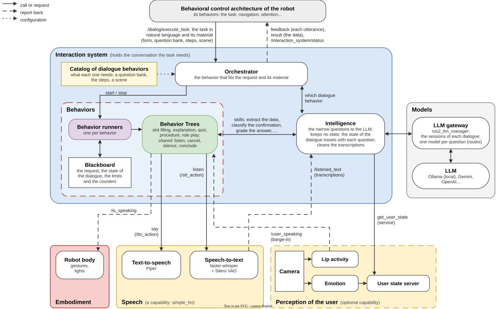
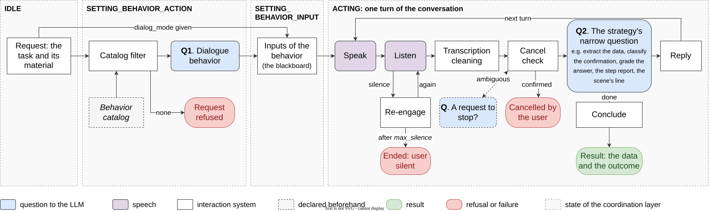

# Architecture: design, nodes and flow

This page explains how the interaction system is built and why: the layers of the capability,
the state machine of a request, the nodes, the processing of one request node by node, how the
Behavior Trees and the interaction intelligence divide the work, and the interpretation server
that asks the model. Each
dialogue behavior and each shared mechanism has its own page in
[docs/behaviors](behaviors/README.md). The parameters and configuration files are described in
[CONFIGURATION.md](CONFIGURATION.md), and every topic, service and action in
[ROS_INTERFACES.md](ROS_INTERFACES.md).

## Interaction as a capability with the robot's layers inside

The interaction system is built with
[`behavior_architecture`](https://github.com/geriabot/behavior_architecture), the framework of
the behavioral control architecture of the GERIABOT robot. The robot is controlled by layers:
deliberation and planning when the context requires them, coordination by a finite state machine
(FSM) that manages the task plan, and action by a *behavior forest* of Behavior Trees, which the
FSM activates phase by phase. The robot's capabilities (perception, navigation, attention,
interaction) are autonomous subsystems, activated by the behaviors that need them. Each
capability can have the same layers inside and offers a standard interface to the rest of the
robot. The interaction system is one of them: it is on the right of the figure, and the robot
running the plan of a social task is on the left.

The interaction system executes requests; it does not decide the robot's task. It is autonomous
in how it holds a conversation, but it makes no decision about what the robot does. A robot
behavior sets the goal through the `DialogTask` action, the interaction system completes it, and
the result says whether it succeeded or failed and why ([endings](behaviors/endings.md)). The
requesting behavior decides what follows: launching the same interaction again, launching another
one, calling a person, or any other mitigation. This is why the mechanisms end a conversation
that is going nowhere instead of prolonging it.



<sub>Editable with draw.io, like the other figures in `media/`.</sub>

| Layer | In the robot's architecture | In the interaction system | Code |
|---|---|---|---|
| Deliberation, planning | Decide the goals and provide the FSM, when needed | Not needed: the goal comes in `/dialog/execute_task`, and the FSM is fixed | — |
| Coordination | An FSM, the task plan | An FSM, the life of a request (below) | `/interaction_orchestrator`, a `BaseOrchestrator` |
| Action | The behavior forest: one tree per phase of the task | One tree per dialogue behavior, each in its own `BehaviorRunner` (a lifecycle node); only the chosen one is active | `interaction_system_behaviors/behavior_tree_xml/*.xml` |
| Capabilities | Perception, navigation, attention, interaction; a task tree such as finding a person uses several of them | User perception (lip activity; emotion, preliminary) and, planned, emotion expression while the robot talks. Speaking and listening go through speech (simple_hri: speech-to-text and text-to-speech), a low-level sub-capability that the trees' own nodes call | simple_hri, `interaction_perception`, `robots/nao` |
| Interpretation | A column beside the layers that consult it: it answers narrow questions about unstructured input and commands nothing | behavior_architecture's interpretation server, configured with the system's questions: which dialogue behavior fits a request (asked for the FSM) and the narrow questions of the dialogue behaviors (asked for the trees). It asks the model; what to do with the answer is decided by the skill that asked | `/interaction/interpretation_server`, `config/interpretation/` of `interaction_intelligence` |
| External service | — | The LLM behind the interpretation server, interchangeable (Ollama, OpenAI-compatible APIs, Gemini, Claude) | — |

A capability, in this sense, is a high-level, orchestrated subsystem of the robot, built with
the same pattern (its own coordination and action layers): perception, navigation, attention,
interaction and, planned, emotion expression. Speech (simple_hri: speech-to-text and
text-to-speech) is not one of them but a low-level sub-capability: a package that the trees of the
interaction system call to speak and to listen, and that another capability, such as emotion
expression, could also use.

For the rest of the robot, the interaction system is one more capability, with the same
interface as any other:

| | What | Interface |
|---|---|---|
| In | Activation and deactivation | ROS 2 lifecycle of `/interaction_orchestrator`, configured and activated by `mission_executor` at start |
| In | The goal and its parameters | `/dialog/execute_task`: the task in natural language and, optionally, the dialogue behavior, a slot schema, values to resume from, resources, a domain and the conversation limits |
| Out | Feedback | The action's feedback on every robot utterance, and `/interaction_system/status` |
| Out | Result | The outcome of the conversation, its data, the reason when it did not complete, and its turns |

The fields of the goal, the feedback and the result are listed in
[ROS_INTERFACES.md](ROS_INTERFACES.md#the-public-interface).

### The coordination layer: the state machine of a request

`/interaction_orchestrator` runs this machine every control cycle (`control_cycle_rate_ms`,
`InteractionOrchestrator::control_cycle`):



| State | What it does | Published as |
|---|---|---|
| `IDLE` | Nothing active; takes the next accepted goal | `IDLE`, or `FAILED` after a conversation that did not succeed |
| `SETTING_BEHAVIOR_ACTION` | Chooses the dialogue behavior: the one `dialog_mode` names, or the one the intelligence chooses ([below](#the-choice-of-the-dialogue-behavior)) | `REASONING` |
| `SETTING_BEHAVIOR_INPUT` | Writes the request (as JSON), the limits and the counters to the blackboard | `REASONING` |
| `ACTING` | Activates the runner of the dialogue behavior, sends the feedback on every new utterance, and sends the result when the tree ends | `RUNNING` (with the dialogue behavior and its phase) |

One conversation runs at a time, because the robot has one microphone and one voice: a goal that
arrives while another is being prepared or run is rejected. Canceling the goal deactivates the
runner, which halts the tree (and with it the voice and the listening) and returns `canceled`.
Deactivating the orchestrator aborts the running conversation. When a conversation ends, the
orchestrator asks the intelligence for the skill `finish`, which cancels the questions of the
conversation still in progress in the interpretation server and closes its transcript.

### Why this design

- A request goes through a few discrete states with explicit transitions, which a state machine
  expresses and logs directly, and which the status topic reports one to one. A conversation is
  reactive and modular (listen, understand, decide, reply, with silences, cancellations and
  interruptions at any point), which is what Behavior Trees are for.
- The control of a conversation is explicit: the phases, the counters and the limits are nodes
  of the tree, visible in the XML and in Groot2, and the same in every run. The LLM never decides
  what happens next: it only answers narrow questions (*understanding*, with a JSON schema) or
  phrases one utterance (*generation*). An LLM that answers badly degrades the conversation, but
  it cannot skip the confirmation, forget a slot or end the task.
- The dialogue behaviors share the handling of silences, the turn limit, the spoken
  cancellation, the exit on a communication breakdown and the endings, which are the same
  subtrees in every tree. Every conversation ends with a closing line and an outcome with its
  reason, so the requesting behavior can act on how it ended.
- The intelligence keeps no state: the state of the conversation travels in the blackboard of the
  tree, so every question can be logged, replayed and tested on its own, and the intelligence can
  be restarted without losing a conversation.
- Any client of `/dialog/execute_task` can play the role of the requesting behavior, so the
  interaction system can be developed, tested and replaced on its own; the same holds for speech
  (simple_hri), user perception and the LLM.
- Only the runner of the chosen dialogue behavior is active, so no two trees compete for the
  voice or the microphone.

## The nodes

The next figure shows the nodes of the interaction system and, around them, the behavioral
control architecture, speech, user perception, the embodiment and the models:



<sub>Editable with draw.io: open `media/interaction_system_architecture.drawio.svg` in diagrams.net
or in VS Code with the Draw.io Integration extension, and save it to the same file.</sub>

| Block | Node | What it does |
|---|---|---|
| Interaction system (`interaction_system`) | `/interaction_orchestrator` | Serves `/dialog/execute_task`, chooses the dialogue behavior, activates its runner, writes the request to the blackboard, sends the feedback and the result, and publishes `/interaction_system/status` |
| | Behavior runners (`/interaction_slot_filling`, `/interaction_explanation`, `/interaction_quiz`, `/interaction_procedure`, `/interaction_roleplay`, `/interaction_grounded_qa`, `/interaction_questionnaire`) | One lifecycle node per dialogue behavior, which ticks its Behavior Tree while active |
| | `/interaction_intelligence` | Answers the skills of the trees and the choice of the dialogue behavior: asks their questions to the interpretation server, applies the answers to the state of the conversation, and writes the transcript. It talks to no model itself |
| | `/interaction/interpretation_server` (behavior_architecture) | Builds the prompt of each question from the system's templates and the arguments it receives, asks the model of the question's route, and returns its text |
| Speech sub-capability | simple_hri (`stt_faster_whisper` or `stt_whisper`, `tts_piper` or `tts_mms`) | Listens and speaks on request ([SPEECH.md](SPEECH.md)) |
| Perception (`interaction_perception`) | `/user_state_server`, `/emotion_detector`, `/lip_activity_detector_node` | The state of the user, served on request; the lip activity as a stream for barge-in |

The orchestrator chooses the dialogue behavior from the request or by asking the intelligence. It
is a plugin of `behavior_architecture` (`mission_executor`), loaded from
`libinteraction_system.so`. Each behavior runner ticks its tree every 50 ms
(`control_period_ms`) and reports the result on `/behavior_status`; the tree nodes
(`libinteraction_system_behaviors_bt_plugins.so`) share one ROS node,
`/interaction_system_bt_node`. For each question of a skill, the intelligence sends the
interpretation server the question's name and the arguments of its prompt; the server builds the
prompt from the prompt templates, asks the model and returns its text, which the intelligence
parses and validates, falling back to a safe answer when the LLM fails. It also cleans the
transcriptions (drops noise).

## A request, node by node



The columns of the figure are the states of the state machine of `/interaction_orchestrator`. In
`SETTING_BEHAVIOR_ACTION`, unless the request names its dialogue behavior, the orchestrator asks
the intelligence. The intelligence filters the catalog by the material of the request and, if
more than one dialogue behavior passes, asks question 1
([below](#the-choice-of-the-dialogue-behavior)). Everything in `ACTING` is the Behavior Tree of
the chosen dialogue behavior: one user turn per cycle, with question 2, the narrow question of
the dialogue behavior, at its center.

The example below is "Take a coffee order", with `dialog_mode: slot_filling` and simple_hri for
speech:

```mermaid
sequenceDiagram
  autonumber
  participant C as Client
  participant O as /interaction_orchestrator
  participant T as runner + Behavior Tree
  participant I as /interaction_intelligence
  participant M as interpretation server and LLM
  participant S as speech (simple_hri)
  C->>O: /dialog/execute_task (task, dialog_mode)
  O->>O: the behavior of the mode (SlotFilling)
  O->>T: the request in the blackboard, activate the runner
  T->>I: begin (the request); closing (error: the line kept for a failure)
  T->>I: slot_filling.prepare
  I->>M: create_frame (understanding), audit_frame
  T->>I: slot_filling.opening
  I->>M: opening (generation)
  T->>S: say (/tts_action); feedback to the client
  loop one user turn per cycle
    T->>S: listen (/stt_action)
    S-->>I: /listened_text
    I-->>T: /interaction/user_utterance (not noise)
    T->>I: cancel_check (exact stop commands locally; the LLM otherwise)
    T->>I: slot_filling.update (what the turn does, the slots; apply them)
    I->>M: extract_slots (understanding, JSON schema)
    T->>I: slot_filling.next_question or confirmation_question
    I->>M: generate_response / ask_confirmation (generation)
    T->>S: say; feedback to the client
  end
  T->>I: result (the outcome and its reason)
  T-->>O: SUCCESS (/behavior_status)
  O-->>C: result (success, outcome, final_frame_json, total_turns)
  O->>I: finish (questions in progress cancelled, transcript closed)
```

Along the way:

- Each skill gets the state of the conversation from the blackboard (`dialogue`) and returns it
  updated, with the reply to say, the label the tree branches on, the phase and the data. A skill
  that cannot run (a quiz without a question bank, a schema with errors) fails with its reason,
  which becomes the `failure_reason` of the result (outcome `error`).
- The feedback is sent when an utterance starts, so the client sees it while the robot speaks.
- While a reply is being prepared (between the user's turn and the `say` that follows), a
  conversational filler on the same voice may precede it, without feedback
  ([Conversational fillers](#the-shared-mechanisms)).

## The frame of the task

What bounds the conversation is the *frame of the task*: the structured list of the elements that
the conversation must go through, each with a state. The requesting behavior sends the frame, or
the material to build it from, in its goal, and gets the frame back filled in the result
(`final_frame_json`, also when the conversation did not complete). The feedback shows the frame
as it fills (`current_frame_json`).

| Dialogue behavior | Elements of the frame | States | Comes in the goal as |
|---|---|---|---|
| Slot filling | fields: typed, with allowed values, ranges and conditions | missing, filled, unanswered | `frame_schema_json` ([format](SLOT_SCHEMA.md)), or designed by the LLM from the task |
| Explanation | key points of the material (critical or not) | pending, correct, wrong | `resources_json`: the material and its key points (or listed by the LLM from it) |
| Quiz | questions of the bank | pending, correct, incorrect, unanswered | `resources_json`: the bank |
| Guided procedure | steps (optional; with a duration) | pending, done, skipped, stuck | `resources_json`: the steps |
| Role play | exchanges of the scene; criteria of the rubric | scored, not scored | `resources_json`: the scene and its criteria |
| Grounded QA | the user's questions, against the material | answered, abstained, declined | `resources_json`: the material |
| Questionnaire | items with their response options | pending, answered, refused, unanswered | `resources_json`: the instrument |

The frame is kept outside the LLM, in the state of the conversation that travels with every
request to the [interaction intelligence](#the-interaction-intelligence). The LLM takes part only
through the frame:

- The LLM is asked one question about the current element and the user's last turn (which value
  does this utterance give for this field? does this restatement cover this key point?), with
  the state of the frame in the prompt.
- Its answer is validated against the frame (the type of the field, its allowed values or range,
  the options of the item) before it changes the state; an answer that does not fit is rejected.
- Its reply is phrased for the element that the tree chose, with the content that the frame and
  its material allow.
- The filled frame, not the LLM's output, is what returns to the requesting behavior, with the
  outcome.

The tree decides which element to work on and when one is done; the LLM never does. How tightly
the frame bounds the LLM depends on the dialogue behavior. In slot filling, the quiz, the
procedure and the questionnaire, each turn is about one element, and what the LLM returns is a
value, a grade, a label or an option (the questionnaire's items are even read without it). In
the role play, the LLM writes the character's lines with more freedom, within the scene and its
criteria.

Frames come from frame-based dialogue systems (form filling, since the 1970s), where
understanding and generation were written by hand and the frame organized what the system had to
obtain. Here the frame takes a second role: it is the contract that governs a generative model.

## The action layer: the dialogue behaviors

Every dialogue behavior begins the conversation, runs one user turn per cycle until the
conversation is done or aborted, and concludes with its outcome:

```text
begin -> open -> say -> repeat { turn limit -> listen -> (spoken cancellation | the strategy's turn)
                                 -> count progress -> say }
                     -> conclude
```

The tree decides with counters and limits; the LLM only classifies the turn or phrases the reply.

### The shared mechanisms

The subtrees shared by every dialogue behavior are in `behavior_tree_xml/common.xml`:

| Subtree | What it does | Page |
|---|---|---|
| `Begin` | Builds the state of the conversation and fetches the fixed closing line for a failure of the system and the conversational fillers | [Endings and outcome](behaviors/endings.md), [Fillers](behaviors/fillers.md) |
| `TurnLimit` | Ends the conversation at `max_turns` (outcome `turn_limit`) | [Endings and outcome](behaviors/endings.md) |
| `ListenToUser`, `UserSilent` | Waits for the user; on a silence, prompts or stays quiet, and ends at `max_silence` (outcome `user_silent`) | [Silence](behaviors/silence.md) |
| `CancelCheck` | A spoken request to stop, confirmed before it ends the conversation (outcome `cancelled`) | [Spoken cancellation](behaviors/cancellation.md) |
| `NoProgress`, `CountProgress` | Count the turns without progress; `max_stalled` in a row end the conversation (outcome `breakdown`) | [Recovery and breakdown](behaviors/no_progress.md) |
| `EndDialogue`, `Conclude` | The closing line of an ending decided by the tree or of a failure (outcome `error`), and the outcome with its reason | [Endings and outcome](behaviors/endings.md) |

Within each dialogue behavior, an element that the user cannot answer (a slot, a question, a
step, an item) has a bounded recovery ladder that ends by leaving it unfinished
([Recovery and breakdown](behaviors/no_progress.md)). Barge-in is in the `Speak` node, not in a
subtree, and is experimental ([Barge-in](behaviors/barge_in.md)).

The conversational fillers are in the `WithFillers` node, which each dialogue behavior wraps
around its opening and around the reply to a user turn. A reply that is not ready after
`filler_after_s` (2 s) is preceded by a fixed filler ("Hmm…"), whose wording changes as the wait
grows (at 5, 9 and 14 s); after that, the last phrase is repeated every `filler_repeat_s` (8 s).
A filler is not a turn and changes no counter ([Conversational fillers](behaviors/fillers.md)).

### The dialogue behaviors

| Dialogue behavior (`dialog_mode`) | What the robot does |
|---|---|
| [Slot filling](behaviors/slot_filling.md) (`slot_filling`) | Collects the slots of a frame (from a [slot schema](SLOT_SCHEMA.md), or designed by the LLM), applies each turn to the frame with deterministic checks, and reads it back for confirmation |
| [Explanation](behaviors/explanation.md) (`explanation`) | Explains a topic and verifies it with teach-back against its key points, explaining again only what was missing or wrong |
| [Quiz](behaviors/quiz.md) (`quiz`) | Asks the questions of a bank, grades each spoken answer and gives the score |
| [Procedure](behaviors/procedure.md) (`procedure`) | Guides the user through a list of steps while the user does them |
| [Role play](behaviors/roleplay.md) (`roleplay`) | Plays a character in a scene, then scores the user on each criterion of a rubric |
| [Grounded question answering](behaviors/grounded_qa.md) (`grounded_qa`) | Answers the user's questions only from the material of the request, verifying each answer and abstaining when the material does not contain the answer |
| [Standardized questionnaire](behaviors/questionnaire.md) (`questionnaire`) | Reads an instrument word for word, maps each answer to an option and computes the score in code |

The outcomes (`completed`, `partial`, `failed`, `cancelled`, `user_silent`, `breakdown`,
`turn_limit`, `error`) are defined in [Endings and outcome](behaviors/endings.md).

### The blackboard

The orchestrator writes its keys before activating the runner; the trees read them and write the
rest:

| Key | Written by | What |
|---|---|---|
| `goal` | Orchestrator | The request as JSON: the `DialogTask` fields, the chosen dialogue behavior, and the resolved `max_turns` and `wait_timeout` |
| `dialogue_id` | Orchestrator | The id of the conversation (the goal's id) |
| `dialogue` | The intelligence, through `AskIntelligence` | The state of the conversation (JSON): the request, the frame (or the bank, the steps or the scene), the history, and the counters of the dialogue behavior |
| `behavior`, `skip_intro` | Orchestrator | From the request |
| `max_turns`, `max_silent_waits`, `max_stalled` | Orchestrator | The limits of the request, or the orchestrator's parameters when the request leaves them unset; `max_silent_waits` is `max_silence` counted in waits of `wait_timeout` (0 = never) |
| `wait_timeout`, `max_attempts`, `tts_timeout`, `intelligence_timeout`, `reasoning_intelligence_timeout`, `reply_budget`, `opening_budget`, `user_speaking_topic` | Orchestrator | The other limits and the barge-in topic (parameters of the orchestrator) |
| `reply_deadline` | Orchestrator (0), `WithFillers` | When the time budget of the reply being prepared ends (steady clock, s; 0 while none is being prepared) |
| `filler_after_s`, `filler_repeat_s` | Orchestrator | When the conversational fillers are said: `filler_after_s` from the request, or the orchestrator's parameter when the request leaves it unset (0 = none) |
| `turns`, `timeouts`, `stalled`, `attempts`, `help`, `done`, `progress` | Orchestrator (zero, `false`, `true`), trees | The counters of the conversation, whether it is done, and whether the last turn made progress |
| `user_text`, `reply`, `label`, `phase`, `data` | Trees | The last utterance of the user, the reply to say, what the last skill found, the phase and the data of the conversation |
| `spoken`, `last_utterance` | `Speak` | How many utterances were said, and the last one |
| `error_closing` | `Begin` | The closing line for a failure of the system |
| `fillers`, `last_filler` | `Begin`, `WithFillers` | The filler phrases (one per line) and the last one said (not repeated in a row) |
| `ending` | Trees | An ending decided by the tree (`user_silent`, `breakdown`, `turn_limit`, `error`) |
| `outcome`, `result_reason` | `Conclude` | The outcome and why it is not `completed` |
| `failure_reason` | `AskIntelligence` | The error of a skill that failed |

Each `AskIntelligence` sends what is left of `reply_deadline` with its request. The counters are,
in order, the user turns, the silent waits in a row, the turns without progress in a row, the
attempts per element and the helps with a step. The orchestrator sends the feedback when `spoken`
changes, and the cancellation and the silence prompts resume with `last_utterance`.

## The choice of the dialogue behavior

A request without `dialog_mode` is resolved by `/interaction/ask_intelligence_for_behavior`. The
orchestrator sends its catalog, with the explanation and the needs of each dialogue behavior. The
intelligence offers only the dialogue behaviors whose needs the request provides, which it
decides by parsing the resources, without the LLM (`interaction_intelligence/selection.py`):

| Need | The request provides it when its resources have |
|---|---|
| `question_bank` | A JSON list of `{question, answer}` (quiz) |
| `steps` | A JSON list of steps (procedure) |
| `scene` | A JSON object with `scenario` and `role` (role play); the scenario names the user in the third person ("The user knocks on..."), never as "you", since the model reads it next to the role it plays |
| `material` | A resource with plain text, not JSON and not named `handover` (grounded question answering) |
| `instrument` | A JSON object with a list `items`, each item with answer options (questionnaire) |

Slot filling and explanation need nothing, so they are always offered. If one dialogue behavior
is offered, it is chosen; if several are, the LLM chooses among them from their explanations
(the question `choose_dialogue_behavior` of the interpretation server, with the system's
template and its answer field `behavior_id`). An answer that is not an offered dialogue behavior falls
back to slot filling (or to the first offered one). If none is offered, the request is aborted.
The orchestrator only accepts an offered dialogue behavior. The catalog is configured as
described in [CONFIGURATION.md](CONFIGURATION.md#the-catalog-of-dialogue-behaviors).

## The interaction intelligence

`/interaction_intelligence` answers two services:

- `/interaction/ask_intelligence_for_behavior`: the choice above.
- `/interaction/ask_intelligence`: one *skill* of a tree, which is either one narrow question to
  the LLM (asked to the interpretation server) or one deterministic operation on the data of the
  conversation. It receives the state
  of the conversation and returns it updated, with the reply, a label, the phase and the data.

| Skills | Described in |
|---|---|
| `begin`, `closing`, `result` | [Endings and outcome](behaviors/endings.md) |
| `fillers` | [Conversational fillers](behaviors/fillers.md) |
| `silence` | [Silence](behaviors/silence.md) |
| `cancel_check` | [Spoken cancellation](behaviors/cancellation.md) |
| `slot_filling.prepare`, `.opening`, `.opening_direct`, `.resume_opening`, `.update`, `.next_question`, `.confirmation_question`, `.classify_confirmation`, `.confirmed`, `.answer_question`, `.correction_reply` | [Slot filling](behaviors/slot_filling.md) |
| `explanation.open`, `.open_direct`, `.check`, `.confirmed`, `.answer`, `.ask_again`, `.targeted`, `.ask_missing`, `.repair`, `.give_up` | [Explanation](behaviors/explanation.md) |
| `quiz.open`, `.first_question`, `.evaluate`, `.repeat`, `.unanswered`, `.next_question`, `.summary` | [Quiz](behaviors/quiz.md) |
| `procedure.open`, `.first_step`, `.classify`, `.advance`, `.answer`, `.help`, `.repeat`, `.back`, `.remind` | [Procedure](behaviors/procedure.md) |
| `roleplay.open`, `.open_direct`, `.classify`, `.reply`, `.repeat`, `.coach`, `.finish` | [Role play](behaviors/roleplay.md) |
| `grounded_qa.open`, `.open_direct`, `.answer` | [Grounded question answering](behaviors/grounded_qa.md) |
| `questionnaire.open`, `.ask`, `.record`, `.clarify`, `.options`, `.unanswered`, `.finish` | [Questionnaire](behaviors/questionnaire.md) |
| `finish` | Asked by the orchestrator when a conversation ends: cancel its questions in progress, close its transcript |

The skills live in `interaction_intelligence/skills/`, one module per dialogue behavior and
`common.py` for the shared ones. [PROMPTS.md](PROMPTS.md) lists the prompt that each skill uses.
Additional skills (for a new dialogue behavior or an ablation) are loaded from Python modules
with the parameter `skill_modules` ([ADDING_DIALOGUE_BEHAVIORS.md](ADDING_DIALOGUE_BEHAVIORS.md)).

### Questions to the model

Every question is asked on its own, with everything its prompt needs: no conversation history is
kept in the model, so extraction prompts never enter the context of a generated line. The
understanding questions carry a JSON schema; the generated lines carry none. The parameter
`routes` sends some questions to a different model (e.g. the extraction to a stronger one)
([MODELS.md](MODELS.md#one-model-per-question-routes)).

### Context

`DialogContext` renders a `[CONTEXT]` block with the domain and the resources (minus the hidden
ones, such as a role play's scene) for the templates that use it
([PROMPTS.md](PROMPTS.md#placeholders-context-and-caching)). It can also carry the user's emotion
from the perception subsystem, but that path is off by default (`user_state_service` is empty)
because the emotion detector is preliminary and not validated
([interaction_perception](../interaction_perception/interaction_perception/README.md)).

### Languages

Everything that depends on the language of the conversation is in one file per language
(`interaction_intelligence/config/languages/<language>.yaml`), selected by the parameter
`language`. The file holds the fixed phrases, the acknowledgments and fillers, the exact stop
commands, the yes/no words, the noise phrases of the recognizer and the speech settings that
`main.launch.py` passes to simple_hri. The prompts are a single English set that asks for the
replies in `{language}`. English and Spanish ship with the system; a language without a file
stops the node at startup ([ADDING_A_LANGUAGE.md](ADDING_A_LANGUAGE.md)).

### Transcriptions

The intelligence subscribes to the transcriptions of speech (simple_hri) and to typed text
(`transcription_topics`). It drops the noise and publishes the rest on
`/interaction/user_utterance`, where `Listen` takes the next utterance. Noise means Whisper
hallucinations such as subtitle credits, fillers and empty text: an utterance made only of the
noise phrases of the language files is dropped, while a noise phrase inside real words keeps the
utterance. The turns taken (`/interaction/user_turn`) and what the robot says
(`/robot_utterance`, and its conversational fillers on `/robot_filler`, with the role `filler`)
go to the transcript (`conversation_log_path`).

### Trace

Every skill asked is published on `/interaction/skill_trace` for diagnosis and evaluation. Each
message is JSON with the conversation, the skill, the label, whether it succeeded, how long it
took, the time budget it got, and its calls to the LLM that timed out or were not made.

### Errors of speech recognition and of the LLM

Noise in the transcriptions is dropped before it reaches the LLM and is never a turn. Every
understanding question includes a JSON schema that the provider enforces (Ollama also runs it at
temperature 0). Its answer is validated and retried and, if still unusable, replaced by a safe
default (e.g. "not understood"); every utterance falls back to a fixed phrase in the
conversation's language ([PROMPTS.md](PROMPTS.md#understanding-and-generation)).

The wait for the LLM is bounded in three ways
([The wait for the model](behaviors/endings.md#the-wait-for-the-model)):

- Each call waits at most `llm_timeout` and is not repeated if it times out; the other calls of
  the same skill then fail at once. A call that may reason is not cut at `llm_timeout`: only a
  hung model is cut, at `reasoning_timeout`.
- All the calls that prepare one reply share its time budget (`reply_budget` from the end of the
  user's turn, `opening_budget` for the opening). Once the budget is spent, they fall back
  without asking the LLM.
- `intelligence_timeout` is the hard limit of a request to the intelligence
  (`reasoning_intelligence_timeout` when the LLM may reason).

A sustained failure therefore ends in one of the shared endings (`breakdown` or `error`) rather
than in a loop or in silence ([Endings and outcome](behaviors/endings.md)).

## The interpretation server

The questions to the model are answered by behavior_architecture's interpretation server
([INTERPRETATION.md](https://github.com/geriabot/behavior_architecture/blob/devel/docs/INTERPRETATION.md)),
which `interaction_system.launch.py` starts in the namespace `interaction` with the interaction
system's own configuration:

| Part | Where | What it holds |
|---|---|---|
| Questions | `interaction_intelligence/config/interpretation/questions.yaml` | One question per method of `LLMDialogClient` that asks the model: its template, its token cap, whether it is a spoken line (`parse: text`, no schema) or an understanding question (with its JSON schema), and the variant `reasoning` of the questions on which the model may reason |
| Question module | `interaction_intelligence/interpretation_questions.py` | `DialogueQuestion`: the prompt and the schema written by `PromptBuilder` from the arguments in the request's context, and the model's text returned as it is |
| Context | `interaction_intelligence/interpretation_context.py` | How the client sends the arguments of a prompt (the frame, the context of the dialogue, the histories...) and how the server reads them |
| Templates | `interaction_intelligence/config/prompts.yaml`, and the `prompts.*` of the parameter files | The prompt templates ([PROMPTS.md](PROMPTS.md)) |
| Routes | written by the launch file (`interpretation_config.py`) | The model of each question, from the model binding ([CONFIGURATION.md](CONFIGURATION.md#the-interpretation-server)) |

What the skills do with an answer stays in the intelligence: `LLMDialogClient` reads the
model's text, validates it, retries, falls back and keeps the limits of the reply's time budget,
and the skills apply the result to the state of the conversation. The server keeps no state and
decides nothing. The choice of the dialogue behavior is one more question
(`choose_dialogue_behavior`, with the system's template and its field `behavior_id`); the filter
of the catalog by the material of the request stays in the intelligence (`selection.py`).

The server's backends cover Ollama (local or on a GPU server), OpenAI and any OpenAI-compatible
server, Gemini and Claude; API keys are read from the environment.
[MODELS.md](MODELS.md) explains which model answers each question and how to change it. The
former LLM gateway (`ros2_llm_manager`) is still in the repository, but it is no longer started.

## Speech, perception and embodiment

- Speech (simple_hri) is a low-level sub-capability that the trees call when they need it.
  `Listen` asks it to listen, and `Speak` (and `WithFillers`, for the conversational fillers) asks
  it to speak, through simple_hri's actions `/stt_action` and `/tts_action`. Both nodes publish
  `/is_speaking` for the embodiment ([SPEECH.md](SPEECH.md)).
- User perception (`interaction_perception`) is a separate, optional subsystem, used through a
  service (the state of the user) and a topic (the lip activity, for barge-in). Without it, the
  conversation only loses the visual barge-in
  ([interaction_perception](../interaction_perception/interaction_perception/README.md)).
- The embodiment (`robots/nao`) consumes only generic signals (`/is_speaking`, `/target_pose`,
  and `/user_vad` if something publishes it) to drive talking gestures, idle poses and eye LEDs.
  The interaction system has no NAO-specific code ([robots/nao](../robots/nao/README.md)).

## The web GUI (`dialostack_gui`)

The GUI is a React single-page app with a small Python server (`server.py`). The server turns the
GUI configuration into a ROS parameter file (the model binding, the intelligence and the
orchestrator) and the speech choices into launch arguments, starts and stops the whole
stack (`main.launch.py`), and serves the default prompts and phrases. The page talks to ROS
through rosbridge.

| Page | What it does |
|---|---|
| Monitor | Shows the conversation live, lets you type as the user or make the robot say something, and exports the session to CSV, JSON or Markdown |
| Frame Builder | Visual editors for the input of each dialogue behavior: slots with types, allowed values, ranges and conditions; quiz banks; procedure steps; role-play scenes and rubrics; resources |
| Prompts | Override any prompt template, with validation of its placeholders |
| Strategies | Edit the fixed phrases of each dialogue behavior per language, including the prompts while the user is silent and the closing line of every ending |
| Configuration | LLM provider and model, the conversation limits, and speech (simple_hri or none) with its speech-to-text and text-to-speech engines, saved as named profiles |

The Monitor's timeline shows the speech, LLM and voice latencies, barge-in marks, the frame
filling up, the user's emotion and camera images. The GUI's internal design is described in
[`dialostack_gui/src/README.md`](../dialostack_gui/src/README.md).

## Limitations

1. One conversation runs at a time; a new request is rejected while one runs, and the requesting
   behavior must cancel the running one first.
2. For the dialogue behaviors that need resources, the choice relies on the resources; between
   slot filling and explanation, it relies on the LLM.
3. The control is in the trees, but what the user said is understood by the LLM: a value
   extracted wrongly but within its type and range reaches the frame, and only the confirmation
   lets the user correct it.
4. With simple_hri, the robot does not listen while it speaks, so the user can only interrupt it
   through the visual barge-in, which is experimental.
