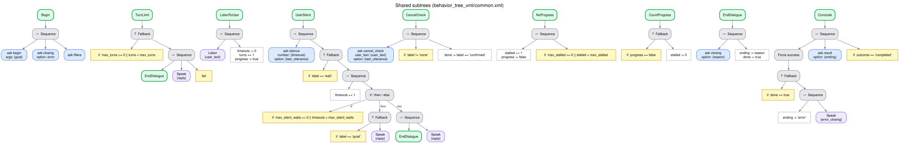

# The dialogue behaviors and their shared mechanisms

This folder has one page per dialogue behavior (strategy) and one per mechanism shared by all of
them. Each page describes what the behavior or mechanism does, what it needs and returns, its
Behavior Tree, how it understands each user turn, and how it handles the edge cases: silence, a
request to repeat, a turn not understood, a cancellation, a failure of the LLM or of speech, and a
limit reached. The questions to the LLM are described in [PROMPTS.md](../PROMPTS.md), and how to
add a behavior in [ADDING_DIALOGUE_BEHAVIORS.md](../ADDING_DIALOGUE_BEHAVIORS.md).

| Strategies | Shared mechanisms |
|---|---|
| [Slot filling](slot_filling.md) (`slot_filling`) | [Silence](silence.md): waiting for the user without giving up too early |
| [Explanation](explanation.md) (`explanation`) | [Spoken cancellation](cancellation.md): "stop, forget it", confirmed |
| [Quiz](quiz.md) (`quiz`) | [Recovery and communication breakdown](no_progress.md): bounded repairs |
| [Procedure](procedure.md) (`procedure`) | [Endings and outcome](endings.md): every conversation closes with a line and a reason |
| [Role play](roleplay.md) (`roleplay`) | [Barge-in](barge_in.md) *(experimental, not validated)*: the user interrupts the robot, which stops and listens |
| [Grounded question answering](grounded_qa.md) (`grounded_qa`) | [Conversational fillers](fillers.md): "Hmm…, let me think" when the reply takes more than two seconds |
| [Standardized questionnaire](questionnaire.md) (`questionnaire`) | |

## What every behavior shares

Every behavior follows the same skeleton of turns
([ARCHITECTURE.md](../ARCHITECTURE.md#the-action-layer-the-dialogue-behaviors)): the tree of the
strategy decides what follows each turn, the LLM only answers narrow questions (understand an
utterance, phrase a reply), and every limit is a counter in the tree. Every conversation ends with
a closing line and an outcome with its reason, returned in the `DialogTask` result
([Endings and outcome](endings.md)).

The limits of a conversation are parameters of the orchestrator
([CONFIGURATION.md](../CONFIGURATION.md#interaction_orchestrator)), and a request can set its own
(`max_turns`, `max_silence`, `max_stalled`, `max_attempts`, `max_off_task`, `wait_timeout`, the
fillers and the time budgets; [ROS_INTERFACES.md](../ROS_INTERFACES.md#dialogtask-goal)). Reaching
the turn limit and a failure of the system end the conversation in the same way in every behavior
([Endings and outcome](endings.md)).

## How to read the figures

The figures are drawn from the XML of the trees (`interaction_system_behaviors/behavior_tree_xml`)
by `interaction_system_behaviors/scripts/bt_diagrams.py`, with Graphviz. Run it after changing a
tree to keep the figures in sync:

```bash
python3 interaction_system_behaviors/scripts/bt_diagrams.py   # writes media/bt/*.svg
```

| Shape | Node |
|---|---|
| Grey, rounded | Control: `→` Sequence, `?` Fallback, `↻` Repeat, if / then / else, and switch |
| Blue, rounded | A question to the interaction intelligence (`AskIntelligence`), named by its skill; it updates the state of the dialogue and writes the reply to say and a label |
| Purple, rounded | Speech: `Speak` (with barge-in), `Listen`, and `WithFillers` (says the conversational fillers while its child prepares the reply) |
| Yellow | A condition on the blackboard (`if ...`), or `fail` |
| White | A blackboard update (`Script`): counters, `done` |
| Green, bold | A subtree. Those of the behavior's own file are expanded below it, with their parameters; those of `common.xml` are a single box, `shared: ...`, drawn on the mechanism's page |

A Sequence runs its children in order and fails at the first child that fails; a Fallback tries
its children in order until one succeeds; a Repeat runs its child until it fails; a switch runs the
branch whose value matches the variable, or the *otherwise* branch when none does.

All the shared subtrees side by side:


