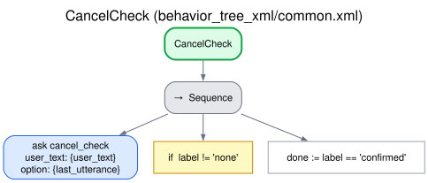

# Spoken cancellation

The user can stop a conversation at any moment by saying so ("stop", "cancel", "forget it").
The robot asks for confirmation first, so that an accidental "stop" does not lose the work, and
only a yes stops: any other answer resumes the conversation where it was, and never reaches the
behavior as if it answered the behavior's own question. Finishing is not canceling: a user who
says they have nothing more to ask or add ("that will be all", "no more questions") has reached
the normal end of the task, not abandoned it.

Shared by every dialogue behavior: subtree `CancelCheck` of `common.xml`, skill `cancel_check`
(`interaction_intelligence/skills/common.py`). [Index](README.md).

## How it works

Every user turn goes first to `CancelCheck`, before the behavior:

1. **Detection.** A local check comes first: an utterance that is exactly one of the stop
   commands of the conversation's language, or one of them repeated, is a cancel request without
   asking the LLM. Any other utterance goes to the LLM (`detect_cancel_intent`, one short
   question per turn), which chooses among three answers: *cancel* (a request to abandon the
   task), *finished* (the user has finished or has nothing more to ask or add, which is the
   normal end of the task) and *none*. Only "cancel" is a cancel request; "finished" and "none"
   go to the behavior like any other turn (in grounded question answering, "finished" leads to
   its own closing). The third answer is needed because a choice between "cancel" and "not
   cancel" failed: the LLM took most closings of grounded question answering ("No, I think
   that's all") for cancel requests, although the question said they were not, and a user who
   answered "No, I have no more questions" to "Do you want to stop?" was read as "no", so the
   conversation looped to the turn limit. The LLM ignored a negative rule, but follows an answer
   of its own for that case more easily.

   The commands are in the language file (`cancel_commands`,
   [ADDING_A_LANGUAGE.md](../ADDING_A_LANGUAGE.md)), and only the whole utterance counts, after
   normalization (case, accents and punctuation removed, whitespace collapsed):

   | Language | Exact stop commands | Examples that are not (the LLM decides) |
   |---|---|---|
   | English | "stop", "exit", "cancel", "quit", "abort" | "cancel please", "the hospital stop" |
   | Spanish | "para", "para ya", "para por favor", "por favor para", "basta", "basta ya", "ya basta", "cancela", "cancelar", "cancélalo", "cancela por favor", "déjalo", "déjalo ya", "dejémoslo", "detente" | "Para mí un café.", "No, para el martes.", "Para llevar.", "No." |

   So "Para.", "¡Para, para!" and "Déjalo." stop the conversation, also when the LLM is down.
   Each language has its own list, so that a user can stop in their own language while the LLM
   is down. Some Spanish words are left out on purpose: "no" (an answer), "alto" and "salir"
   (answers to a question), "olvídalo" (it may drop only the last value) and "terminar" (the way
   the role play asks to end the practice, which is evaluated: [role play](roleplay.md)).

   A request to stop has too many forms ("para, no quiero seguir", "let's drop this") for a word
   list, so every utterance that is not an exact command goes to the LLM: a keyword filter in
   front of it missed most requests, and every request in Spanish. While slot filling asks for a
   slot with allowed values (*strict* mode, `DialogueMode.strict_cancel`), cancel-like words are
   ordinary answers ("the hospital stop", "para llevar"), so the LLM is told to accept only an
   explicit request to stop the whole conversation. The LLM is still asked in strict mode: with
   the exact commands alone, a user could not stop while choosing an option with words such as
   "Para, déjalo" or "Wait, stop".
2. **Confirmation.** The robot asks whether the user wants to stop and remembers what it had
   asked before (its last utterance). The question is a short generated yes/no question
   (`ask_cancel_confirmation`; fallback "Are you sure you want to cancel?") in which "yes" means
   stopping. It does not explain how to answer, and like every spoken line it addresses the user
   directly and informally ([PROMPTS.md](../PROMPTS.md#placeholders-context-and-caching)).
3. **The answer to the confirmation** (`classify_cancel_reply`):

| Answer | Label | The robot | The conversation |
|---|---|---|---|
| Yes | `confirmed` | A brief generated closing (`cancel_confirmed_response`; fallback "Alright, cancelled."), never a question (below) | Ends: outcome `cancelled`, reason `Cancelled by the user` |
| No | `denied` | "OK, let's continue." (`cancel_no`) and what it had asked before | Goes on |
| Finished: they have nothing more to ask or add ("No, I have no more questions"), in a behavior whose end the user decides (grounded question answering) | `finished` | The behavior's own closing (`DialogueMode.on_finished`; grounded QA: "Alright. Have a good day!") | Ends normally: the behavior's own outcome (`completed`), not a cancellation |
| Finished, in a behavior whose end the user does not decide | `denied` | As for no | Goes on |
| Anything else ("No, I want to finish the boat", the value it had asked for, "can you repeat?") | `denied` | As for no | Goes on: the robot asks its question again (a value said there is said once more) |

The closing after a confirmed cancellation is the robot's last line, so it must not invite
another turn: the code replaces a generated closing that contains a question mark with the
fallback.

Only a yes stops, and every other answer resumes. An answer that is neither a yes nor a no is not
passed to the behavior: the LLM tends to take the words after a "no" as content ("No, I want the
plumber to come"), and the behavior would then record them as a value or as skipping the item.
Rewording the prompt reduced this for every LLM tested, but not enough in Spanish; with this rule,
the LLM's reading matters only as to whether the answer is a yes. The cost is one more turn: a
value said in answer to "do you want to stop?" is asked for again.

When the user did not ask to stop, the label is `none` and the behavior handles the turn.

After a denial, the robot resumes with its last utterance without the "OK, let's continue." of an
earlier denial, so that repeated denials do not pile up the phrase ("OK, let's continue. OK, let's
continue. Is there anything else...?").

The LLM reads the answer to the confirmation. A fallback reads it only when the LLM gives no
usable answer: an error, no answer in time, a call not made because the reply's budget is spent,
or an answer that is not yes, no, finished or other. The fallback normalizes the whole answer as
for the stop commands. If it is exactly one of the language's `yes_words` ("Yes.", "Sí.",
"Vale."), the answer is yes; if it is exactly one of its `no_words` ("No."), it is no; anything
else is something else, and the robot resumes ("Yes, but first the size" does not stop). The word
lists are not the method but a fallback (`utils.local_yes_no`), like the fixed phrases said when
the LLM fails. Without it, a failed reading would always withdraw the cancellation, and nobody
could stop the conversation while the LLM was down.

### When the LLM is down

With the LLM known to be down, an exact stop command ends the conversation at once. The LLM is
down when the last call to it in this conversation failed and none has answered since. A call
fails when it returns an error, gives no answer in time, is not made because the budget is spent,
returns an understanding answer that is not JSON, or generates a line too short to say. An
utterance that is exactly a stop command of the language (step 1) then gets no confirmation
question: the robot says the fixed cancel closing of the language (`cancel_ok`, "Alright,
cancelled."), and the outcome is `cancelled` by the user. The label is `confirmed`, so the
measures count it as a confirmed cancellation without a question, as in the
`no_cancel_confirmation` ablation. The confirmation exists to avoid stopping by mistake; an exact
command is unambiguous, and with the LLM down the answer to the question could not be read anyway.
While the LLM works nothing changes: an exact command gets the question, and the LLM reads the
answer. The fallback above covers an LLM that fails during the confirmation.

The LLM client records whether its last call gave a usable answer (`model_status`), and the
intelligence keeps it in the state of the dialogue (`model_down`), the JSON object the tree sends
with every request. It is kept there because the intelligence keeps no state between requests and
builds a client per request. A request without a call to the LLM leaves the value unchanged.

### The behavior's own closing, and canceling the goal

When a behavior has something to give for what was done, a cancellation, whether confirmed or
immediate, closes with the behavior's own closing instead of the generic one
(`DialogueMode.on_cancel`): the role play gives the evaluation of the exchanges so far when the
user said at least one line of the scene ([Role play](roleplay.md)). The stop is then the end
the user chose, not an abandoned task: the outcome is the behavior's own (`completed` when every
criterion was scored), and what it recorded (the scores) is in `final_frame_json`. With the
generic closing the outcome is `cancelled`.

The requesting behavior can also cancel the goal of `/dialog/execute_task`: the conversation stops
at once, without a closing line, with the outcome `cancelled` and the reason `Cancelled`.

### What the words are about

The detector first decides what the words are about. It is given the task description (not the
robot's last line) and decides whether the words are about this conversation (stopping it,
leaving it) or about something in the task (an answer, a value, a step done), even when a word
such as "cancel" appears: "I need to cancel my card" in a bank task and "I've pressed the cancel
button" in a procedure are about the task. Words about the task are never a cancel request,
whatever the rest of the answer says (the code enforces it), and they go to the behavior without
a question. A hesitant wish to drop the conversation ("maybe I should just forget about it") is
"cancel", since the robot confirms it anyway. When the user denies a cancellation, the robot
resumes with what it had asked, and the same words are not asked about again, as a safety net for
a false alarm the detector did not catch. The turn that triggered the question is not passed to
the behavior, because a retracted real request ("forget it", then "no") would reach the behavior
and could be read as "skip this item".

## Tree

## Edge cases

| Situation | What happens |
|---|---|
| The LLM fails while detecting the request | No cancellation: the behavior handles the turn. An exact stop command gets the confirmation question (the fixed phrase), or ends the conversation at once if the LLM was already down |
| The LLM is known to be down (its last call failed) and the user says an exact stop command | No question: the fixed cancel closing (`cancel_ok`), outcome `cancelled` ([above](#when-the-llm-is-down)) |
| The LLM fails while classifying the answer to the confirmation | The fallback reads it: exactly a yes word of the language confirms; anything else resumes |
| The user says a cancel-like word while answering a slot with allowed values | Strict mode: the LLM takes only an explicit request to stop as one; an answer that names an option is not |
| The intelligence does not answer | A failure of the system: outcome `error` ([Endings](endings.md)) |

Ablations of this mechanism (detection by keywords only or by the LLM only, no confirmation) are
in `evaluation/ablations` ([evaluation/README.md](../../evaluation/README.md#ablations)).
