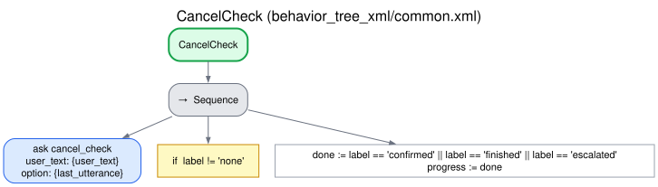

# Spoken cancellation

The user can stop a conversation at any moment by saying so ("stop", "cancel", "forget it").
The robot asks for confirmation first, so that an accidental "stop" does not lose the work, and
only a yes stops: any other answer resumes the conversation where it was, and never reaches the
behavior as if it answered the behavior's own question. Finishing is not canceling: a user who
says they have nothing more to ask or add ("that will be all", "no more questions") has reached
the normal end of the task, not abandoned it.

Shared by every dialogue behavior: subtree `CancelCheck` of `common.xml`, skill `cancel_check`
(`interaction_intelligence/skills/common.py`). [Index](README.md).

## How it works

Every user turn goes first to `CancelCheck`, before the behavior. Its first question is whether
the user tells of an urgency ([Urgencies](urgencies.md)); then:

1. **Detection.** A local check comes first: an utterance that is exactly one of the stop
   commands of the conversation's language, or one of them repeated, is a cancel request without
   asking the LLM; in a procedure, an utterance that is exactly one of the language's
   `step_done_words` ("Done.") is never one, also without asking the LLM
   ([procedure](procedure.md)). Any other utterance goes to the LLM (`detect_cancel_intent`, one short
   question per turn), which chooses among three answers: *cancel* (a request to abandon the
   task), *finished* (the user has finished or has nothing more to ask or add, which is the
   normal end of the task) and *none*. "cancel" is a cancel request, and "none" goes to the
   behavior like any other turn. "finished" goes to the behavior where the user decides the end
   (in grounded question answering it leads to its own closing), and to the behaviors where
   saying one has finished is a normal reply to the current element (`finishing_is_an_answer`:
   in a procedure "Done" or "I'm relaxed enough, I'll skip it" reports or skips the step, in an
   explanation "I'm done" answers the check, in a role play the line belongs to the scene, in
   slot filling "That's all" goes to the reading of the frame); in the quiz and the
   questionnaire there is no normal end of the user's to give, so "I'm done, that's enough" is a
   request to stop and is asked about (in a quiz it was graded as an answer, and the quiz went
   on). Answering "I'm done" to the question whether to stop agrees to stop in every behavior. The third answer is needed because a choice between "cancel" and "not
   cancel" failed: the LLM took most closings of grounded question answering ("No, I think
   that's all") for cancel requests, although the question said they were not, and a user who
   answered "No, I have no more questions" to "Do you want to stop?" was read as "no", so the
   conversation looped to the turn limit. The LLM ignored a negative rule, but follows an answer
   of its own for that case more easily.

   The commands are in the language file (`cancel_commands`,
   [ADDING_A_LANGUAGE.md](../ADDING_A_LANGUAGE.md)), and only the whole utterance counts, after
   normalization (case, accents and punctuation removed, whitespace collapsed):

   | Language | Exact stop commands | Examples that are not (the LLM decides) |
   |---|---|---|
   | English | "stop", "exit", "cancel", "quit", "abort" | "cancel please", "the hospital stop" |
   | Spanish | "para", "para ya", "para por favor", "por favor para", "basta", "basta ya", "ya basta", "cancela", "cancelar", "cancélalo", "cancela por favor", "déjalo ya", "dejémoslo", "detente" | "Para mí un café.", "No, para el martes.", "Para llevar.", "No." |

   So "Para.", "¡Para, para!" and "Basta." stop the conversation, also when the LLM is down.
   Each language has its own list, so that a user can stop in their own language while the LLM
   is down. Some Spanish words are left out on purpose: "no" (an answer), "alto" and "salir"
   (answers to a question), "olvídalo" and "déjalo" (they may drop only the last value, or mean
   "leave it as it is") and "terminar" (the way
   the role play asks to end the practice, which is evaluated: [role play](roleplay.md)).

   A request to stop has too many forms ("para, no quiero seguir", "let's drop this") for a word
   list, so every utterance that is not an exact command goes to the LLM: a keyword filter in
   front of it missed most requests, and every request in Spanish. While slot filling asks for a
   slot with allowed values (*strict* mode, `DialogueMode.strict_cancel`), cancel-like words are
   ordinary answers ("the hospital stop", "para llevar"), so the LLM is told to accept only an
   explicit request to stop the whole conversation. The LLM is still asked in strict mode: with
   the exact commands alone, a user could not stop while choosing an option with words such as
   "Para, déjalo" or "Wait, stop".
2. **Confirmation.** The robot asks whether the user wants to stop and remembers what it had
   asked before: the element the user was to answer (the slot's question, the quiz question,
   the questionnaire item with its options, the step, the teach-back request, the character's
   last line, "anything else?"; `DialogueMode.pending`), or its last utterance when the behavior
   gives none (the read-back while confirming the data). The question is a fixed yes/no question of the language
   file (`cancel_ask`: "Do you want to end our conversation here?", "¿Quieres que lo dejemos
   aquí?") in which "yes" means stopping. It was first generated, and a small model at times
   phrased it as an alternative ("Want to stop or need more info?"), whose "no" could not be
   read. It names the conversation, not "stopping", because in a task that is itself about
   stopping or canceling something (a newspaper delivery, a bank card) "Do you want to stop
   here?" was answered "Yes, I need to cancel my card here", about the card.

   In a behavior whose end the user decides (grounded question answering, the topic-bounded social
   conversation), stopping and finishing are the same once something was done there (a question within the task got its
   reply: `DialogueMode.stop_is_finishing`). A request to stop, an exact command or one the LLM
   read as such, then ends the conversation with the behavior's own closing, a normal end (label
   `finished`), without a confirmation, also while the LLM is down. Most such requests are
   goodbyes ("No, that's all, thank you" after "Is there anything else?"): a user who has
   finished and walked away does not answer a confirmation, and the robot was left waiting
   through two silences before its closing. The cost is that a hesitation after an answer ("Hmm,
   maybe I'll leave it") is taken for a goodbye. Before any answer, a request to stop is a
   cancellation, confirmed as in the other behaviors, so a hesitation there is asked about.
3. **The answer to the confirmation** (`classify_cancel_reply`, given the task description and
   the user's words that led to the question, so that a "yes" about something the task deals
   with, "Yes, I need to cancel my card" in a bank task, is read as going on with the task, not
   as a yes to ending the conversation; a bare yes, "Yes." or "Yes, please", is a yes without
   the LLM, as described below):

| Answer | Label | The robot | The conversation |
|---|---|---|---|
| Yes | `confirmed` | A brief generated closing (`cancel_confirmed_response`; fallback "Alright, cancelled."), never a question (below) | Ends: outcome `cancelled`, reason `Cancelled by the user` |
| No | `denied` | "OK, let's continue." (`cancel_no`) and what it had asked before | Goes on |
| Finished: they have nothing more to ask or add ("No, I have no more questions"), in a behavior whose end the user decides (grounded question answering, topic-bounded social conversation) | `finished` | The behavior's own closing (`DialogueMode.on_finished`; grounded QA: "Alright. Have a good day!"; the topic-bounded conversation: its summary and goodbye) | Ends normally: the behavior's own outcome (`completed`), not a cancellation |
| Finished, in a behavior whose end the user does not decide ("Yes, I'm done for today") | `confirmed` | As for yes | Ends as for yes: there is no normal end of the user's to give, and resuming went against the user's will |
| Anything else ("No, I want to finish the boat", the value it had asked for, "can you repeat?") | `denied` | As for no | Goes on: the robot asks its question again (a value said there is said once more) |

The closing after a confirmed cancellation is the robot's last line, so it must not invite
another turn: the code replaces a generated closing that contains a question mark with the
fallback.

Only a yes stops, and every other answer resumes. An answer that is neither a yes nor a no is not
passed to the behavior: the LLM tends to take the words after a "no" as content ("No, I want the
plumber to come"), and the behavior would then record them as a value or as skipping the item.
Rewording the prompt reduced this for every LLM tested, but not enough in Spanish; with this rule,
the LLM's reading matters only as to whether the answer is a yes. The cost is one more turn: a
value said in answer to "do you want to stop?" is asked for again.

When the user did not ask to stop, the label is `none` and the behavior handles the turn.

After a denial, the robot resumes with that element, not with its whole last utterance (which
may hold an acknowledgment, the feedback on an answer or a whole explanation). When it resumes
with its last utterance, it leaves out the "OK, let's continue." of an earlier denial, so that repeated denials do not pile up the phrase ("OK, let's continue. OK, let's
continue. Is there anything else...?").

A bare yes is read without the LLM: when the whole answer, normalized as for the stop commands,
is exactly one of the language's `yes_words` ("Yes.", "Yes, please", "Sí.", "Vale."), it is yes.
It answers the yes/no question and nothing else, and the small model read it as not answering in
about one confirmation in four, even when its prompt said that a bare yes is always yes; the
robot then went on against the user's answer. The LLM reads every other answer. A fallback reads
it only when the LLM gives no usable answer: an error, no answer in time, a call not made because the reply's budget is spent,
or an answer that is not yes, no, finished or other. The fallback normalizes the whole answer as
for the stop commands. If it is exactly one of the language's `yes_words` ("Yes.", "Sí.",
"Vale."), the answer is yes; if it is exactly one of its `no_words` ("No."), it is no; anything
else is something else, and the robot resumes ("Yes, but first the size" does not stop). The word
lists are not the method but a fallback (`utils.local_yes_no`), like the fixed phrases said when
the LLM fails. Without it, a failed reading would always withdraw the cancellation, and nobody
could stop the conversation while the LLM was down.

### Silence after the question, and a question left over

The question whether to stop never stays pending by mistake:

- If the user says nothing after it, the robot asks it again once; if the silence goes on, the
  conversation ends without prompting until `max_silence`, as a silence ends it: with the
  behavior's own closing for what was done, and its own outcome. Where stopping is finishing
  (grounded question answering after an answer), that is its normal end; otherwise its closing
  for a silence (`on_silent_end`; the role play: its evaluation). A user who says goodbye at the
  end of the task and leaves has completed it. Only when the behavior has no closing of its own,
  the conversation ends as the user asked, with the fixed cancel closing (`cancel_ok`) and the
  outcome `cancelled`, reason `The user asked to stop, then said nothing`.
- If the request to stop came on the last turn allowed (`max_turns`), the conversation ends as the
  user asked instead of with the turn limit: the cancel closing, outcome `cancelled`, reason
  `The user asked to stop at the turn limit` (or, where stopping is finishing, the behavior's own
  closing).
- If the request that read the answer failed (the intelligence did not answer in time), the
  behavior took that turn, and the robot asked something else, the question is no longer the
  robot's last line: it is dropped, so that a later "yes" to another question (the read-back)
  does not cancel.
- If the LLM fails while reading the answer, or while detecting the request, the skill still
  returns the state of the dialogue: the answer is read by the fallback below, and the
  detection counts as no request (an exact stop command still does).

### When the LLM is down

With the LLM known to be down, an exact stop command ends the conversation at once. The LLM is
down when the last call to it in this conversation failed and none has answered since. A call
fails when it returns an error, gives no answer in time, is not made because the budget is spent,
returns an understanding answer that is not JSON, or generates a line too short to say. An
utterance that is exactly a stop command of the language (step 1) then gets no confirmation
question: the robot says the fixed cancel closing of the language (`cancel_ok`, "Alright,
cancelled."), and the outcome is `cancelled` by the user. The label is `confirmed`, so the
measures count it as a confirmed cancellation without a question, as in the
`no_cancel_confirmation` ablation. The confirmation exists to avoid stopping by mistake; an exact
command is unambiguous, and with the LLM down the answer to the question could not be read anyway.
While the LLM works nothing changes: an exact command gets the question, and the LLM reads the
answer. The fallback above covers an LLM that fails during the confirmation.

The LLM client records whether its last call gave a usable answer (`model_status`), and the
intelligence keeps it in the state of the dialogue (`model_down`), the JSON object the tree sends
with every request. It is kept there because the intelligence keeps no state between requests and
builds a client per request. A request without a call to the LLM leaves the value unchanged.

### The behavior's own closing, and canceling the goal

When a behavior has something to give for what was done, a cancellation, whether confirmed or
immediate, closes with the behavior's own closing instead of the generic one
(`DialogueMode.on_cancel`): the role play gives the evaluation of the exchanges so far when the
user said at least one line of the scene ([Role play](roleplay.md)). The outcome stays
`cancelled`; what the behavior recorded (the scores) is in `final_frame_json`.

The requesting behavior can also cancel the goal of `/dialog/execute_task`: the conversation stops
at once, without a closing line, with the outcome `cancelled` and the reason `Cancelled`.

### What the words are about

The detector first decides what the words are about. It is given the task description, the
stage of the dialogue behavior (in slot filling: the details are being collected or read back,
and nothing has been booked, ordered or sent yet) and the robot's last line, and decides whether
the words are about this conversation (stopping it, leaving it) or about something in the task
(an answer, a value, a step done, a thing that exists apart from the conversation), even when a
word such as "cancel" appears: "I need to cancel my card" in a bank task and "I've pressed the
cancel button" in a procedure are about the task. Dropping what the conversation is preparing
("cancel the booking, I've changed my mind", "forget the order") is about the conversation: the
robot carries nothing out until the conversation ends, so withdrawing the request means stopping
it. Read as about the task, such a request at the read-back would be an unclear answer, and a
"yes" that followed would confirm the data. Words about the task are never a cancel request,
whatever the rest of the answer says (the code enforces it), and they go to the behavior without
a question. A hesitant wish to drop the conversation ("maybe I should just forget about it") is
"cancel", since the robot confirms it anyway. When the user denies a cancellation, the robot
resumes with what it had asked, and the same words (normalized: case, accents and punctuation
removed) are not asked about again while the user is on the same element (the same question,
step, item, or slot being asked for), as a safety net for a false alarm the detector did not
catch ("Done, I've pressed cancel" looped otherwise). An exact stop command is never set aside:
it is unambiguous and the confirmation already protects it, so a sincere "Stop." after an
earlier denied one is heard. The turn that triggered the question is not passed to
the behavior, because a retracted real request ("forget it", then "no") would reach the behavior
and could be read as "skip this item".

A question whether to stop, or a denied request, is not progress: it leaves the count of turns
without progress as it was ([No progress](no_progress.md)), so a false alarm does not reset it
and repeated hesitations do not keep a stalled conversation going.

## Tree

## Edge cases

| Situation | What happens |
|---|---|
| The LLM fails while detecting the request | No cancellation: the behavior handles the turn. An exact stop command gets the confirmation question (the fixed phrase), or ends the conversation at once if the LLM was already down |
| The LLM is known to be down (its last call failed) and the user says an exact stop command | No question: the fixed cancel closing (`cancel_ok`), outcome `cancelled` ([above](#when-the-llm-is-down)) |
| The LLM fails while classifying the answer to the confirmation | The fallback reads it: exactly a yes word of the language confirms; anything else resumes |
| The user says a cancel-like word while answering a slot with allowed values | Strict mode: the LLM takes only an explicit request to stop as one; an answer that names an option is not |
| The user says a cancel-like word while answering an item of a questionnaire, or in a line of a role play | The LLM is told where the conversation is (`DialogueMode.cancel_stage`: the items are closed-choice questions; lines said in character are part of the practice), so "I stop to rest quite often" or "I'd like to cancel my reservation" said in character are about the task. Not strict mode: a hesitant wish to stop ("maybe that's enough for today?") is still asked about |
| A reply whose every word is in one of the answers the robot expects ("Cancel." to "open an account or cancel a card?", "Stop." when it is the quiz answer), or that names a whole answer of two or more words in a sentence ("I'd like to cancel my contract, please.") | It is that answer (`DialogueMode.expected_answers`): never a request to stop, and the LLM is not asked, also when it is down. Given the option, a small model still read "Cancel." as a wish to stop. A user who did mean to stop hears the read-back and can say so again |
| At the read-back of the data, a reply that opens with a yes ("Yes, that's correct.", "Sí, es eso.") | It is the confirmation (`DialogueMode.yes_is_an_answer`, slot filling while confirming): the LLM is not asked. The read-back of a request to "cancel a card" made a small model read the confirmation as a request to stop. Only the first clause counts: "Okay let's stop here" still goes to the LLM |
| The intelligence does not answer | A failure of the system: outcome `error` ([Endings](endings.md)) |

Ablations of this mechanism (detection by keywords only or by the LLM only, no confirmation) are
in `evaluation/ablations` ([evaluation/README.md](../../evaluation/README.md#ablations)).
