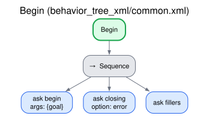
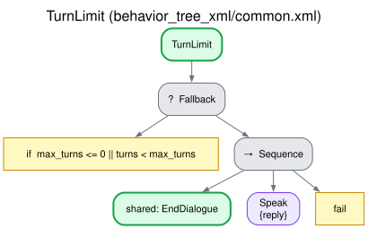
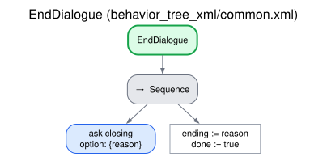
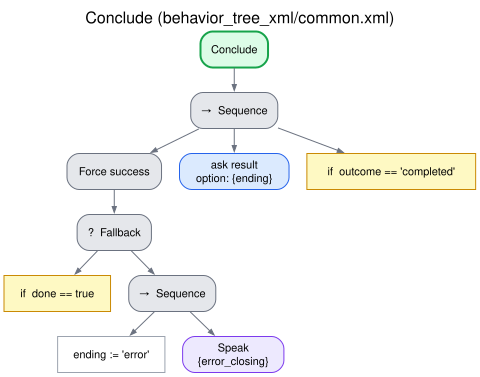

# Endings and outcome

Every conversation that starts ends with a closing line and a known reason. The robot never falls
silent without saying why, and the requesting behavior (the robot behavior that asked for the
conversation) receives the outcome and its reason in the `DialogTask` result, so that it can act
on it: retry later, call a person, keep the partial data. This page defines the outcomes and how
the trees reach them.

An ending that is not a success is not a dead end. A conversation is a component that the
requesting behavior invokes. When it ends without success (a breakdown, the turn limit, an
`error`), the requesting behavior receives the outcome and its reason and decides what follows,
such as launching the same interaction again, launching another one, or calling a person. That is
why the mechanisms end a conversation that is going nowhere (sustained misunderstanding, a user
who keeps asking for something else) instead of prolonging it: a clear ending with its reason is
what the requesting behavior needs in order to decide.

Shared by every dialogue behavior: subtrees `Begin`, `TurnLimit`, `EndDialogue` and `Conclude` of
`common.xml`, skills `begin`, `closing` and `result` (`interaction_intelligence/skills/common.py`).
[Index](README.md).

## The outcomes

| Outcome (`DialogTask.Result.OUTCOME_*`) | Decided by | Closing line | `failure_reason` |
|---|---|---|---|
| `completed` | The behavior: every element done | The behavior's own (confirmation, score, summary, feedback) | Empty |
| `partial` | The behavior: it ended normally, some element left unfinished | The behavior's own | Which elements: `Unanswered slots: ...`, `Steps not done: ...`, and the like |
| `failed` | The behavior: its goal was not achieved | The behavior's own (e.g. the explanation gives up) | E.g. `Critical points not verified after 3 checks: ...` |
| `cancelled` | The user (spoken cancellation, below) or the requesting behavior (action cancel) | Generated, or fixed with the LLM down (below); none when the requesting behavior cancels | `Cancelled by the user` / `Cancelled` |
| `user_silent` | The tree: `max_silence` reached ([Silence](silence.md)) | Fixed, `close_user_silent` | `The user stayed silent for max_silence seconds` |
| `breakdown` | The tree: `max_stalled` turns in a row without progress ([Recovery and breakdown](no_progress.md)) | Fixed, `close_breakdown` | `Communication breakdown: max_stalled turns in a row without progress` |
| `breakdown` (off task) | The tree of grounded QA: `max_off_task` requests in a row outside the task ([grounded QA](grounded_qa.md)) | Fixed, `close_off_task` | `Off-task: max_off_task requests outside the task in a row` |
| `turn_limit` | The tree: `max_turns` reached | Fixed, `close_turn_limit` | `Max turns reached` |
| `error` | A failure of the system, or a request that cannot run | Fixed, `close_error` ("I'm sorry, something went wrong and I have to stop here."), when the conversation had started | What failed (below) |

A spoken cancellation is confirmed by the user, or is immediate when the user says an exact stop
command while the LLM is down. Its closing line is generated (e.g. "Alright, cancelled."), or the
fixed `cancel_ok` with the LLM down, or the role play's evaluation when the user said a line of the
scene ([Spoken cancellation](cancellation.md)). A user who says they have finished does not cancel:
that is the behavior's normal end. The off-task reason is told apart from a misunderstanding so
that the requesting behavior can decide what to do, for example launch the interaction that serves
what the user asks for.

Only `completed` is a success (`success` is `true` and the goal succeeds); every other outcome
aborts the goal, except the cancellation by the requesting behavior, which returns `canceled`.
`final_frame_json` carries the data of the conversation in every case (the frame, the grades, the
steps, the scores), so a `partial` or `breakdown` conversation still returns what was obtained.
The fixed lines follow the language of the conversation (they are `close_*` of its language
file, [ADDING_A_LANGUAGE.md](../ADDING_A_LANGUAGE.md)) and can be edited in the GUI's
Strategies page or with the parameters `phrases.close_*`
([CONFIGURATION.md](../CONFIGURATION.md#interaction_intelligence)).

The `failure_reason` of an `error` says what failed:

| `failure_reason` | Cause |
|---|---|
| `Unknown dialog mode 'x'. Available: [...]` | `dialog_mode` is not in the catalog |
| `No dialogue behavior fits the request` | Without `dialog_mode`, no behavior of the catalog is offered for the request |
| `Choosing the dialogue behavior failed: ...` | The service that chooses the behavior failed |
| `The interaction intelligence is not available` | `/interaction/ask_intelligence_for_behavior` did not appear in time |
| `The behavior runner <runner> could not be activated` | The runner did not reach the active state (e.g. an invalid tree) |
| `The interaction system was deactivated` | The orchestrator was deactivated during the conversation |
| `The interaction intelligence did not answer (<skill>)` | A skill did not answer within `intelligence_timeout`: the intelligence itself failed to answer (an LLM that does not answer is bounded earlier, [below](#the-wait-for-the-model)) |
| The error of a skill | A skill could not run: e.g. the request lacks what the behavior needs (`The quiz requires ...`), or the slot schema is invalid |

## How it works

- `Begin` starts every conversation: builds its state from the request (`begin`) and fetches
  the closing line for a failure of the system (`error_closing`), so that the robot can say it
  even if the intelligence fails later; it also fetches the conversational fillers (`fillers`,
  [Conversational fillers](fillers.md)).
- `EndDialogue` (reason: `user_silent`, `breakdown`, `turn_limit` or `off_task`) asks for the fixed
  closing line (`closing`, no LLM: it works when the LLM is what failed), records the ending and
  marks the conversation as done; the tree that called it says the line.
- `TurnLimit` runs at the start of every cycle: when `max_turns` user turns have been taken
  (`0` = unlimited) it ends the conversation with its closing line and stops the loop.
- `Conclude` runs when the loop stops. If the conversation is not marked as done, the loop
  stopped because a skill failed: the robot says `error_closing` and the ending is `error`. Then
  `result` gives the outcome: the ending decided by the tree if any, `cancelled` if the user
  canceled, otherwise the behavior's own (`DialogueMode.outcome`). The tree succeeds only if
  the outcome is `completed`.
- The orchestrator returns the outcome and the reason: for `error`, the error of the node
  that failed; otherwise the reason given by `result`.

## The wait for the model

An LLM that hangs must neither keep the user waiting nor end the conversation: the robot answers
with its fallback within a bounded time, and the conversation goes on (and, if the LLM stays
down, ends as a `breakdown`). There are three limits, from the innermost:

| Limit (default) | Where | What it bounds |
|---|---|---|
| `llm_timeout` (15 s) | Intelligence | One call to the LLM |
| `reasoning_timeout` (120 s) | Intelligence | One call that may reason (selective reasoning, `reasoning: critical`) |
| `reply_budget` (20 s); `opening_budget` (30 s) for the opening | Orchestrator (`WithFillers`) | All the calls that prepare one reply of the robot |
| `intelligence_timeout` (30 s); `reasoning_intelligence_timeout` (300 s) when the LLM may reason | Orchestrator (`AskIntelligence`) | One request to the intelligence: the hard limit |

A call that reaches `llm_timeout` is not asked again, and the other calls of the same skill fail
at once: the LLM is taken as unresponsive for the rest of that request. A call that fails fast (an
error) or answers something invalid is asked again while there is time.

A call that may reason is not cut: it is bounded neither by `llm_timeout` nor by the reply's
budget, and the time it takes is not charged to the budget (the other calls of the reply keep
theirs). Only a hung LLM reaches `reasoning_timeout`; it is then taken as unresponsive, as with
`llm_timeout`, and the question falls back to its safe default.

The reply budget is counted from the end of the user's turn (for the opening, from its start).
Each skill request carries what is left of it (`budget_s`); once it is spent, no call is made and
the questions fall back to their safe defaults (a fixed phrase, "not understood"), so the robot
speaks its fallback instead of waiting.

Past `intelligence_timeout`, the conversation ends with the `error_closing` line and the outcome
`error`. A request never gets more budget than `intelligence_timeout` minus 2 s, so that a skill
that spends its budget still answers in time. A conversation whose LLM may reason
(`DialogTask.reasoning` not 0) gets the longer limit, which leaves room for the two reasoning
calls of the skill that makes the most: the answer from the material and its verification, 120 s
each.

With a hung LLM, a turn unfolds as follows. The user stops speaking, and the fillers come at 2,
5, 9 and 14 s ([Conversational fillers](fillers.md)). The first call waits 15 s and times out, so
the rest of that skill falls back at once; the next skill of the same reply waits only for what
is left of the 20 s, and the rest make no call. The robot starts its fallback line about 20 s
after the user stopped speaking (the bound is the start of the line, not its end). Whether the
turn counts as progress follows the behavior's usual rule for that fallback: a turn not understood
does not, so an LLM that stays down ends the conversation as a `breakdown` after `max_stalled`
turns, each bounded by the budget. In normal operation the budget is not reached: a turn takes a
few seconds.

The values follow from how long a user can be kept waiting. When the LLM does not answer, the
user must wait at most 20 to 30 s for the robot's line, with the fillers said meanwhile, and the
reply budget takes the lower end, 20 s. One call gets 15 s rather than the whole budget, so that a
single lost call still leaves time for the rest of the turn. The opening gets 30 s because it may
design the frame or list the key points and then generate the longest text (an explanation), and
its normal latency is several times that of a turn. `intelligence_timeout` (30 s) is above every
budget and is reached only when the intelligence itself does not answer. With longer limits, such
as 120 s per call with one retry and 300 s per request, a turn with a hung LLM could last about
ten minutes.

A call that reasons runs to its end, with the fillers said meanwhile, and its latency is
measured, so that whether the wait is acceptable is decided from the measurements rather than by
a limit set before them. Only an LLM that hangs is bounded, at 120 s. A reasoning
call that answers nothing usable (its reasoning ran past the token allowance, or it returned no
JSON) is asked again at once without reasoning, within the usual limits.

When the LLM is down, the user can still stop the conversation
([Spoken cancellation](cancellation.md#when-the-llm-is-down)).

These limits are part of the method, and every deployment and experiment keeps them, except an
experiment that does not test them, which may lift them for all its conditions alike
(`model_wait` of an experiment file, [evaluation/README.md](../../evaluation/README.md)). The
comparison of the method with the LLM-led conversation (experiment E1) does so, because it
includes large cloud models that reason before answering: no reply has a budget, a call waits up
to 90 s and a request up to 300 s, so that every LLM answers and its latency is measured rather
than cut. A budget per reply would cut the method, which asks two or three narrow questions per
turn, more often than the LLM-led conversation, which asks one. Setting `reply_budget`,
`opening_budget` or `llm_timeout` to 0 removes that limit; `intelligence_timeout` is always
positive.

## Trees

## Edge cases

| Situation | What happens |
|---|---|
| The request lacks what the behavior needs (e.g. a quiz without a question bank) | `begin` fails before the robot says anything: outcome `error` with the reason, and no closing line (the conversation never started) |
| The LLM is unavailable | The questions fall back: replies to fixed phrases of the language, understanding questions to their safe default (not understood). If the outage lasts, the conversation ends as a `breakdown` |
| The intelligence does not answer a skill within `intelligence_timeout` | Outcome `error`, with the `error_closing` line |
| The LLM does not answer (a call hangs) | The call is abandoned after `llm_timeout`; once `reply_budget` is spent, the robot says its fallback line, after the fillers, and the conversation goes on ([above](#the-wait-for-the-model)) |
| Text-to-speech is not available, or an utterance lasts more than `tts_timeout` | The utterance is skipped, or cut, with a warning in the log; the conversation goes on ([SPEECH.md](../SPEECH.md#how-the-trees-use-it)) |
| Speech-to-text is not available | Every wait for the user ends empty: the conversation ends as `user_silent` |
| The requesting behavior cancels the goal | The conversation stops at once (no closing line), outcome `cancelled` |

How a robot behavior can act on each outcome:
[INTEGRATING.md](../INTEGRATING.md#2-ask-for-a-conversation).
