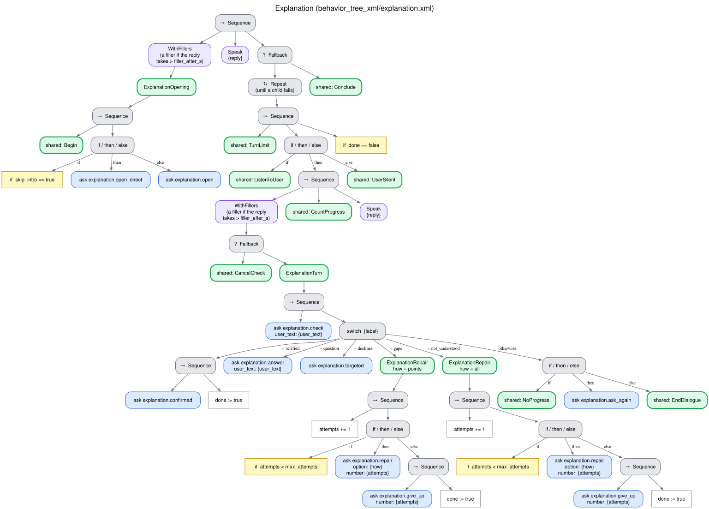

# Explanation (`explanation`)

The robot explains a topic (from the task and, if given, a reference text) and verifies that it
was understood with teach-back: it asks the person to say it back in their own words, judges
the answer against the key points of the explanation, and explains again only what was
missing or wrong. A plain "yes, I understood" is not taken as evidence. Typical uses:
instructions for a test or a medication, the directions of a route, rules. Tree
`behavior_tree_xml/explanation.xml`, skills `interaction_intelligence/skills/explanation.py`.
[Index](README.md).

## Why teach-back

Asking "did you understand?" is weak evidence of understanding. In tutoring, the answers to "Do
you understand?" proved very misleading (N. K. Person, A. C. Graesser, J. P. Magliano and R. J.
Kreuz, Learning and Individual Differences 6(2):205–229, 1994, p. 205,
[doi:10.1016/1041-6080(94)90010-8](https://doi.org/10.1016/1041-6080(94)90010-8)), and patients
rate their understanding of discharge instructions higher than their physicians do (C. Lin, A.
Tirosh and A. Landry, Internal and Emergency Medicine 10:993–1002, 2015, p. 995,
[doi:10.1007/s11739-015-1311-8](https://doi.org/10.1007/s11739-015-1311-8)). In teach-back, the
person explains the content back in their own words, and the explainer clarifies what is missing
or wrong and checks again; it is recommended as a health-literacy communication approach in
several policy documents and position statements (Talevski et al., PLOS ONE 15(4):e0231350, 2020,
p. 2, [doi:10.1371/journal.pone.0231350](https://doi.org/10.1371/journal.pone.0231350)). For short
content, and when the person does not want to paraphrase, the behavior asks instead a direct
question about the most important point.

## What it needs and returns

- **Needs:** the content to explain: a reference text (a plain-text resource), the key points, or
  both. The explanation and the answers use the reference text as the ground truth. The key
  points can come in a resource whose content is a JSON object:

  ```json
  {"key_points": ["No solid food from midnight",
                  "Clear water is allowed until 6 am",
                  {"point": "No chewing gum or sweets", "critical": false}]}
  ```

  A string is a critical point; `{"point", "critical"}` marks it explicitly. Critical points are
  the ones the person needs to do the task safely and correctly (times, doses, places, what must
  not be done). Without key points in the request, the LLM lists them from the task and the
  reference text when the dialogue begins (`extract_key_points`). A request with neither is
  refused before any conversation (outcome `not_feasible`, "The task needs an explanation, but no
  reference text or key points were provided"): the robot checks the user's understanding against
  the key points, so they must come from content that someone provided, not from what the model
  believes about the topic
  ([the choice of the dialogue behavior](../ARCHITECTURE.md#the-choice-of-the-dialogue-behavior)).
- **Returns:** `{attempts, completed, checks, self_reported, key_points}`, with the status of
  each key point (`correct`, `incomplete` with the part said, `wrong` with what the person said,
  or `pending`) and whether the
  person said they understood without saying it back (`self_reported`).
- **Outcome:** `completed` when every critical point was said back correctly (understanding
  verified); `failed` ("Critical points not verified after N checks: ...") otherwise.

## Flow

1. The robot explains the topic and asks: "I want to make sure I explained it well. Could you
   tell me in your own words?" (a fixed phrase: the check is framed as a check of the robot's
   explanation, not an exam of the person).
2. Each reply is judged against the key points in one question to the LLM (`judge_teach_back`):
   what the reply is, and the status of each key point in it. A paraphrase is enough; a
   different time, dose, place or order is wrong. A point said back correctly stays verified and
   is no longer sent to the judge, which judges only the points still to verify: with a verified
   point in the list, the LLM could put the content of another point in the verified point's
   entry and lose that other point. A point said only in part, with nothing false, is
   `incomplete` and is handled as missing, never as wrong: the robot confirms the part said and
   asks only for the rest, and an incomplete point alone is not progress.
3. A reply that says some points back correctly and none wrongly makes progress: the robot
   confirms them and asks only for the critical points still missing, without explaining them
   again ("Good, you remember the green flag. And what does the red one mean?"). Otherwise the
   robot repairs only what is missing or wrong and checks again, until every critical point is
   verified or `max_attempts` checks have failed.

## How each reply is understood

| The person | Label | The robot | Counts as a failed check |
|---|---|---|---|
| Says it back, every critical point correct | `verified` | Confirms briefly and closes (`completed`) | — |
| Says some points back correctly (new ones) and none wrongly, a critical point still missing | `progress` | Confirms what was right and asks only for the critical points still missing, without explaining them again (`ask_missing_points`) | No |
| Says it back, a critical point missing or wrong, without progress | `gaps` | Explains again only the points missing or wrong, reworded, correcting what was wrong and confirming what was right; asks again ("Could you tell me again in your own words?") | Yes |
| Asks a question | `question` | Answers it from the material, then asks the last check again | No |
| Only says they understood, or does not want to say it back | `declines` | The fallback: a direct question about the most critical point not yet verified ("Just to be sure: until what time can you drink water?") | No (the first time); declining the direct question counts as `gaps` |
| Says they did not understand, or asks to hear it again | `not_understood` | Explains the whole topic again in another way and asks again | Yes |
| Anything else (off-topic, unintelligible) | `other` | Asks the last check again | No, but a turn without progress ([Recovery](no_progress.md)) |

After `max_attempts` failed checks (by default 3 checks, that is, 2 repairs), the robot closes by
reminding the user of the critical points ("No worries, feel free to ask me again. Let me remind
you of the most important points: ...", fixed phrases and the points themselves) with the outcome
`failed`. The answer to the direct question of the fallback is judged the same way as a teach-back,
so a correct answer verifies that point; the other critical points still have to be said back.

A restatement in which no key point is correct, incomplete or wrong (nothing of the explanation
was said, e.g. unintelligible speech) is a turn without progress, not a failed check; an answer
of "I don't know" to the direct question of the fallback is still a failed check. A missing detail
that changes nothing of what the person must know or do does not make a point incomplete.

## Tree



## Edge cases

| Situation | What happens |
|---|---|
| Silence | [Silence](silence.md) (the 2nd prompt repeats the check) |
| "Stop" | [Spoken cancellation](cancellation.md) |
| `max_stalled` replies in a row without progress | [Breakdown](no_progress.md) |
| The LLM fails to judge a reply | Read as `other`: the check is asked again, and a sustained failure ends as a breakdown |
| The LLM fails to list the key points | The task itself becomes the only (critical) key point |
| The LLM fails to generate a text | A fixed phrase of the language, or the key points themselves |
| Turn limit, failure of the system | [Endings](endings.md) |

## Parameters

`max_attempts` is the number of failed checks before the robot closes. The shared limits are
described in [What every behavior shares](README.md#what-every-behavior-shares). The fixed phrases
are
`phrases.teach_back`, `phrases.teach_back_again`, `phrases.understand_ok`, `phrases.understand_fail`
and `phrases.key_points_summary` ([CONFIGURATION.md](../CONFIGURATION.md#interaction_intelligence)).
