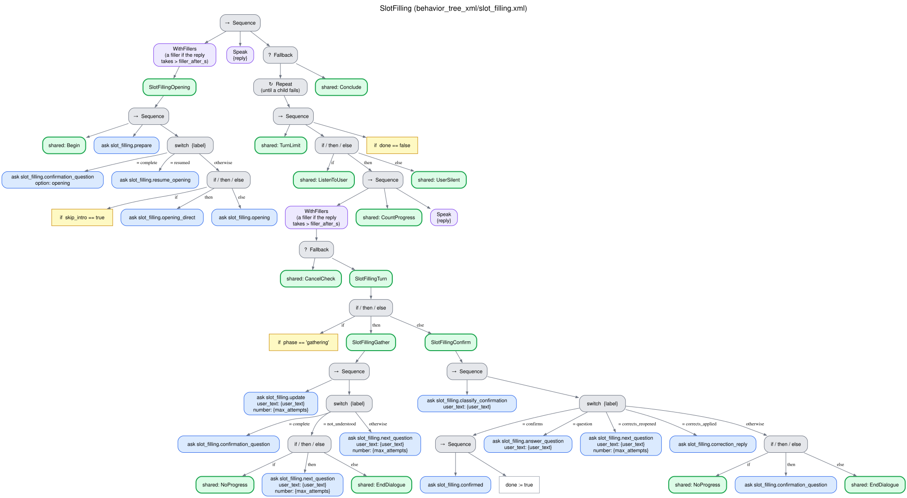
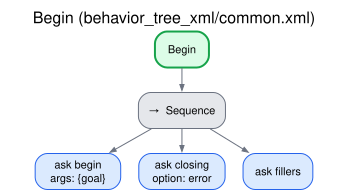

# Conversational fillers

When the robot has to answer and its reply is not ready after a couple of seconds (the LLM is
still working on it), the robot says a short fixed phrase, "Hmm…", so that the person knows it
heard them and is working on the answer, instead of facing a silence of several seconds. If the
wait grows, the wording changes with it ("One moment…", "Let me think about it for a moment…",
"Almost there…", then "Still on it, just a second…" every few seconds), so that a long wait is
never silent and never the same phrase over and over.

Shared by every behavior: the `WithFillers` node of the trees (`interaction_system_behaviors`),
which wraps what prepares each reply, and the skill `fillers`
(`interaction_intelligence/skills/common.py`), which gives the phrases. [Index](README.md).

## Why

Shiwa et al. (2009) measured how people perceive the response time of a robot in conversation
and concluded that "a robot should perform conversation fillers if it cannot respond in two
seconds": the filler moderates the negative impression of a long response time
(T. Shiwa, T. Kanda, M. Imai, H. Ishiguro and N. Hagita, *How quickly should a communication
robot respond? Delaying strategies and habituation effects*, International Journal of Social
Robotics 1(2):141–155, 2009, p. 153,
[doi:10.1007/s12369-009-0012-8](https://doi.org/10.1007/s12369-009-0012-8)). A reply that
depends on an LLM can take several seconds on modest hardware, so the system applies
that rule: two seconds by default.

## How it works

The time counts from the moment the robot has to answer: the end of the user's turn (when the
utterance is taken as a turn), or the start of the conversation for the opening.

| The reply is... | The robot |
|---|---|
| Ready before `filler_after_s` (2 s) | Says the reply; no filler |
| Not ready at `filler_after_s` (2 s) | "Hmm…" |
| Still not ready 3 s later (5 s) | "One moment…" |
| Still not ready at 9 s | "Let me think about it for a moment…" |
| Still not ready at 14 s | "Almost there…" |
| Still not ready after that | "Still on it, just a second…" every `filler_repeat_s` (8 s: at 22, 30 s…) |
| Ready | Says it at once; if a filler is being said, right after it ends |

The steps fall at `filler_after_s` + 0, 3, 7 and 12 s, so a request that moves the first filler
moves the whole ladder. A ladder of steps keeps a longer wait from falling silent, which a fixed
pair of fillers would not.

The fillers are fixed phrases, never generated: they are said while the LLM is busy preparing the
reply, so they cannot come from it. They are a small fixed set per language (`filler_phrases` of
the language file, [ADDING_A_LANGUAGE.md](../ADDING_A_LANGUAGE.md)), one per step of the ladder,
in order; the last one repeats:

| Language | Fillers, in the order of the ladder |
|---|---|
| English | "Hmm…", "One moment…", "Let me think about it for a moment…", "Almost there…", "Still on it, just a second…" |
| Spanish | "Mmm…", "Un momento…", "Déjame pensarlo un momento…", "Ya casi lo tengo…", "Sigo con ello, un segundito…" |

A filler is not a turn and does not count as an utterance of the conversation. It does not
advance or reset any counter, whether of user turns, silent waits, turns without progress or
attempts at an element. It is not the robot's last utterance, which the silence prompts and the
spoken cancellation repeat. It sends no feedback to the client, and the user is not expected to
answer it: the user's next turn answers the reply.

A filler never blocks the reply, which is said as soon as it is ready. A filler that is being said
is allowed to finish, since it lasts about a second and cut in the middle of a word it would sound
like a fault; the reply follows it. The opening follows the same rule: a conversation does not
start with a filler unless its opening also takes more than `filler_after_s` (e.g. the LLM designs
the form first).

Every record marks the fillers. They are announced separately from the lines of the conversation
(`/robot_filler`, not `/robot_utterance`): the transcript of the intelligence writes them with the
role `filler`, and the records of the simulation and of the real sessions keep them, in order and
with their time, as robot lines with `"filler": true`.

### Where it is in the trees, and why there

Every dialogue behavior wraps the two places where the robot prepares a reply in `WithFillers`: its
opening subtree, and the reply to a user turn (the spoken cancellation check and the behavior's
turn). `WithFillers` is a decorator: it ticks its child (the questions to the interaction
intelligence) and, while the child is still running, says the fillers when they are due, through
the same speech package as `Speak`; when the child ends, it returns the child's result once
the filler being said has finished. The `Speak` that follows says the reply.

The alternatives were to let each `AskIntelligence` node say the fillers, or to build them in the
XML with a parallel branch. A reply is often several questions in a row (the cancellation check,
understanding the turn, phrasing the reply), so no single question knows how long the user has
been waiting, and a parallel branch would cut the filler when the reply is ready and needs the
filler to stay out of `spoken` and `last_utterance` anyway. The decorator holds the whole wait in
one node, is visible in every tree and its figures, and leaves the counters to the subtrees that
own them.

The phrases are fetched once, by the shared `Begin` subtree (skill `fillers`, one phrase per
line, in the language of the conversation), as the closing line for a failure is: they are said
while the intelligence is busy, so they must already be in the tree.

## Trees

The filler node in a behavior (slot filling; every dialogue behavior has the same two):

## Edge cases

| Situation | What happens |
|---|---|
| The reply is ready in under `filler_after_s` | No filler |
| The reply comes while a filler is being said | The filler ends, then the reply |
| The LLM does not answer (a call hangs) | The ladder until the reply's time budget (`reply_budget`, 20 s) is spent, then the robot's fallback line; the conversation goes on ([The wait for the model](endings.md#the-wait-for-the-model)) |
| The reply never comes (the intelligence itself does not answer within `intelligence_timeout`) | The ladder, then the last filler every `filler_repeat_s`; then the failure of the system: the closing line for an error, outcome `error` ([Endings](endings.md)) |
| A skill fails while the robot waits | The same: the filler being said ends, then the closing line for an error |
| The user speaks during a filler | The filler is not cut (it is short), and the user's words are not a turn, since the robot is not listening while it prepares the reply. A barge-in can cut the reply that follows ([Barge-in](barge_in.md)) |
| The goal is canceled during a filler | The tree is halted: the filler is cut, like any utterance ([Spoken cancellation](cancellation.md)) |
| Text-to-speech is not available | The filler is skipped; the conversation goes on |
| A closing line, a silence prompt, a confirmation of a cancellation | Fixed phrases, ready at once: no filler is ever needed (the cancellation check and its confirmation are inside the wrapped reply, so a slow check gets a filler) |
| `filler_after_s` is 0 | No fillers |
| `filler_repeat_s` is 0 | The four steps of the ladder at most |
| `filler_phrases` is set to blanks only | Taken as unset: the set of the language file (to turn the fillers off, `filler_after_s` 0) |

## Parameters

| Parameter | Where | Default | Meaning |
|---|---|---|---|
| `filler_after_s` | Orchestrator ([CONFIGURATION.md](../CONFIGURATION.md#interaction_orchestrator)); per request in the `DialogTask` goal ([ROS_INTERFACES.md](../ROS_INTERFACES.md#dialogtask-goal)) | `2.0` | Seconds without a reply before the first filler; `0` = no fillers. A request that leaves it unset (`-1`) uses the orchestrator's |
| `filler_repeat_s` | Orchestrator; per request in the `DialogTask` goal | `8.0` | After the ladder, seconds between fillers (the last phrase); `0` = none after the ladder |
| `filler_phrases` | Intelligence ([CONFIGURATION.md](../CONFIGURATION.md#interaction_intelligence)) | `[""]` | The phrases, in the order of the ladder (the last one repeats); empty: the set of the language file of `language`. `phrases.filler` overrides it, as `phrases.ack` does the acknowledgments |

The topic `/robot_filler` (`std_msgs/String`, each filler when it starts) is in
[ROS_INTERFACES.md](../ROS_INTERFACES.md#the-public-interface); `/is_speaking` is also true
during a filler, for the embodiment.
