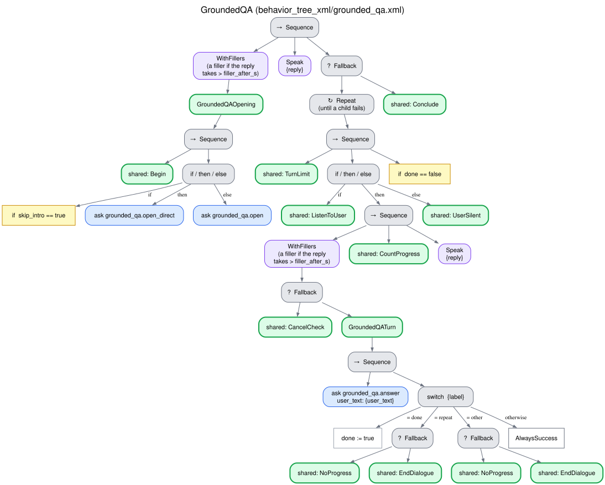

# Grounded question answering (`grounded_qa`)

The user asks and the robot answers only from the information it was given: it never answers
from the general knowledge of the LLM, says so when it does not have the information, and
declines what is outside the task. Typical uses: the reception desk of a hospital or a hotel, a
museum, a station, a library. Tree `behavior_tree_xml/grounded_qa.xml`, skills
`interaction_intelligence/skills/grounded_qa.py`. [Index](README.md).

## Why it is built this way

An information-seeking dialogue is where a robot with an LLM is most tempted to invent:
a question about the topic whose answer is not in the information still gets a fluent answer. So
the strategy separates three cases (in the material, in the topic but not in the material, outside
the task), abstains in the second instead of guessing, and verifies every answer against the
material before saying it.

## What it needs and returns

- **Needs:** the material, that is, the resources of the request with plain text (a structured
  resource, such as a question bank, is not material). Optionally a resource named `handover`,
  whose content is the sentence that offers a person when the answer is not in the material
  ("The staff at the ticket desk can help you with that"). Without material the request fails
  before the robot speaks.
- **Returns:** `{questions, answered, abstained, declined}`; each question with its resolution
  (`answered`, `abstained` or `declined`) and the answer given.
- **Outcome:** `completed` when the user says they have no more questions.

## How each turn is understood

One question to the LLM (`answer_from_material`) reads the turn against the material and, when
the answer is there, drafts it with only facts of the material. A second question
(`verify_answer`) checks that every claim of the draft is supported by the material; only then is
it said. Advice of the robot's own is a claim the material does not support, even when it is
reasonable ("boarding closes 15 minutes before departure, so arrive half an hour early"): the
robot gives only what the material says, because the verification cannot tell sensible advice
from invented advice.

The first thing that question decides is what the person does. The person either asks for
something (a question or a request, with or without a question mark: "I wanted to know the
price", "No, but what time does it close?"), has finished (wants nothing more: "No", "No, thanks",
"That will be all", "I have no more questions", "Goodbye"), or only reacts, without asking
anything and without saying they have finished ("Thanks, that was helpful", "Okay", "What a
shame", "30 euros, perfect"). Only a turn that asks can be answered from the material, and the
code enforces it whatever the rest of the LLM's answer says: like the verification, it is a
property of the system that the robot never volunteers information nobody asked for. Left to the
LLM, the rule was not followed: even with "if nothing is asked, it cannot be answered" written in
the question, an LLM answered turns that asked nothing ("Thank you, that was helpful" got a ticket
price, which the verification passes because it is true).

After "anything else?", a "no" is the end, and a thanks alone is a reaction. Every answer ends
with "anything else?", so taking a thanks for the end would close too early: a user may thank the
robot and then ask another question.

| The user | The robot | Progress |
|---|---|---|
| Asks something whose answer is in the material | The answer, verified, then "Is there anything else you'd like to know?" | Yes |
| Asks something within the topic whose answer is not in the material | "I don't have that information.", the handover if given, and "Is there anything else you'd like to know?" (fixed phrases) | Yes |
| Asks something whose drafted answer is not supported by the material | The same abstention: an answer that does not pass the verification is never said | Yes |
| Asks something outside the task (also help with their own matters: what to buy or choose), or asks for an opinion or a service the robot does not give | "That is outside what we are talking about here, so I can't help you with it; I can only answer questions about the information I have." and "Is there anything else you'd like to know?" | Yes |
| Only reacts, without asking and without saying they have finished ("Thanks, that was helpful", "what a shame", the answer repeated back) | "Is there anything else you'd like to know?" (not recorded as a question) | Yes |
| Has finished: wants nothing more ("No", "No, thanks", "That will be all", "I have no more questions", "Goodbye") | "Alright. Have a good day!" and the conversation ends (`completed`) | — |
| Asks to repeat the last answer | The last answer again (no LLM), or the invitation to ask if there is none yet | No |
| Anything else (off-topic noise, unintelligible) | "Could you repeat that?" | No |

Finishing is never a cancellation: the cancellation detector answers "finished" and leaves the
turn to the strategy. If the robot did ask "do you want to stop?" and the user answers that they
have no more questions, the conversation ends with the same closing
([Spoken cancellation](cancellation.md)).

The abstention, the declining and the closing are fixed phrases, never generated, so the robot
cannot add facts in them.

The tree counts the requests in a row that are declined as outside the task; a question within
the task (answered or abstained) restarts the count, and a reaction leaves it unchanged. After
`max_off_task` such requests (6 by default, also settable per request) the robot closes with
`close_off_task` (outcome `breakdown`, reason `Off-task: …`), so that the requesting behavior
knows the user wanted something else.

What the person does has a fourth value, `unclear`, for words that do not make sense as something
a person could say here (unintelligible speech, a word salad, filler words). Such a turn is not
understood, whatever the rest of the answer says: the skill returns it with the label `other`, a
turn without progress, so that a sustained run of them ends as a breakdown. A closing is verified
before the dialogue ends (`verify_finished`: did the person say they want nothing more? A question
of any kind is not), just as an answer is verified before it is said; an unverified closing is a
turn not understood ("Could you repeat that?").

## Tree

## Edge cases

| Situation | What happens |
|---|---|
| Silence | [Silence](silence.md) |
| "Stop" | [Spoken cancellation](cancellation.md); once confirmed, the outcome is `cancelled` even if some questions were answered (below) |
| `max_stalled` turns in a row without progress | [Breakdown](no_progress.md) |
| The LLM fails to read a turn | The label `other` (a turn not understood, as for the value `unclear` [above](#how-each-turn-is-understood)): the robot asks to repeat; a sustained failure ends as a breakdown |
| The LLM fails to verify an answer | The answer is not said: the robot abstains |
| No material in the request | `error` before the robot speaks |
| Turn limit, failure of the system | [Endings](endings.md) |

`completed` means that the whole task was done. After a cancellation, the questions with their
resolution are still returned in `final_frame_json`, and the requesting behavior decides what
follows.

## Parameters

The shared limits are described in
[What every behavior shares](README.md#what-every-behavior-shares). The fixed phrases are
`phrases.qa_invite`, `phrases.qa_more`, `phrases.qa_abstain`, `phrases.qa_decline` and
`phrases.qa_bye` ([CONFIGURATION.md](../CONFIGURATION.md#interaction_intelligence)).
