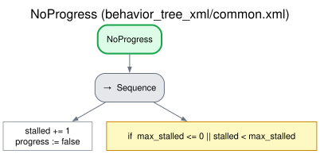
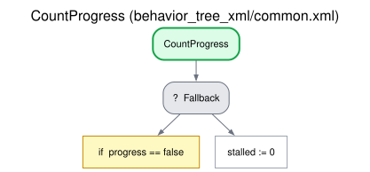

# Recovery and communication breakdown

When the robot does not understand a turn, or the user asks for something again, it tries to
repair the exchange, but the repairs are bounded: a person who cannot follow is not kept in an
endless loop of "could you repeat that?". There are two levels.

1. **Per element** (a slot, a question, a step), inside each strategy: repeat, then simplify, then
   leave that element unfinished and go on.
2. **For the whole conversation**, shared: after `max_stalled` user turns in a row without
   progress, the robot says that it seems they are not understanding each other and closes the
   conversation with the outcome `breakdown`, so that the requesting behavior knows why and can
   act (call a person, try later).

The LLM only classifies each turn; the tree counts and decides. Subtrees `NoProgress` and
`CountProgress` of `common.xml`. [Index](README.md).

## Per element: the recovery ladder

| Strategy | Turn that needs a repair (not always a [turn without progress](#for-the-whole-conversation-the-breakdown-exit)) | 1st repair | 2nd repair | Then |
|---|---|---|---|---|
| [Slot filling](slot_filling.md) | No value, no question, no "I don't know" | Asks again | After `max_attempts` failed attempts on the slot, asks it differently (a closed question) | One more failed attempt: the slot is left unanswered |
| [Quiz](quiz.md) | Not an answer (asks to repeat or clarify, did not hear) | The question again, literally | The question in simpler words, without revealing the answer | At `max_attempts`: the question is left unanswered (not graded wrong) |
| [Procedure](procedure.md) | "I'm stuck" (a problem) | Help with the step | More help | At the `max_attempts`-th problem on the step: it is marked stuck and the procedure goes on |
| [Explanation](explanation.md) | A teach-back with a critical point missing or wrong, or not understood | Explains again only the points missing or wrong (or the whole topic) | Again, in different words | After `max_attempts` failed checks: closes by reminding the user of the critical points, outcome `failed` |
| [Questionnaire](questionnaire.md) | An answer between options | The options again, without suggesting any | The options again | At `max_attempts`: the item is left without an answer |
| [Role play](roleplay.md) | Did not hear or understand the character's last line | The line again, literally | The character says it again in different words | `max_stalled` such requests in a row: [breakdown](#for-the-whole-conversation-the-breakdown-exit) |

An element left unfinished makes the outcome `partial` (a procedure step only if it is not
optional), and the result says which.

The user can also skip an element on purpose: "I don't know" or "skip it" for a slot (left
unanswered), "skip" for a step. "I don't know" in a quiz is an answer (wrong).

## For the whole conversation: the breakdown exit

`ListenToUser` sets `progress := true` on every user turn. The strategy's branches for a turn
without progress call `NoProgress` (`stalled += 1; progress := false`), as the condition of an
if / then / else: *then* the strategy's repair, *else* (`stalled` reached `max_stalled`)
`EndDialogue` with the reason `breakdown`. After the strategy handled the turn, `CountProgress`
resets `stalled` if the turn had progress.

Turns that count as without progress:

| Strategy | Turns |
|---|---|
| Slot filling | Gathering: nothing understood (no value, no question, no skip). Confirming: an unclear answer |
| Quiz | A reply that is not an answer |
| Procedure | Unclear (a reminder is given), and a request to repeat the step |
| Explanation | A reply that is none of the expected ones (off-topic, unintelligible): the check is asked again |
| Role play | A request to repeat the character's last line, and a turn the LLM could not read (every other line of the user is part of the scene) |
| Grounded question answering | A request to repeat the last answer, and a turn not understood |
| Questionnaire | An answer between options (with its own limit per item: the options again, then the item without an answer), a request to repeat the item, and a turn not understood |

A request to repeat counts because a person who asks for everything again and again is not
following; one repetition is harmless, since any turn with progress resets the count.

## Trees

## Edge cases

| Situation | What happens |
|---|---|
| `max_stalled` turns in a row without progress | The closing line "It seems we are not understanding each other well. Let's leave it here and pick it up another time.", outcome `breakdown`, reason "Communication breakdown: max_stalled turns in a row without progress" |
| `max_stalled` is 0 | No breakdown exit: only the per-element ladders and the turn limit bound the conversation |
| The LLM fails while classifying a turn | The turn is read as not understood (the safe default of each question), so a sustained LLM failure ends as a breakdown, not in an endless loop |
| A filler word from the user ("hmm") | Dropped as noise: a silence, not a turn ([Silence](silence.md)) |

## Parameters

`max_stalled` and `max_attempts` are parameters of the orchestrator
([CONFIGURATION.md](../CONFIGURATION.md#interaction_orchestrator)); a request can set its own
`max_stalled` and `max_attempts` ([ROS_INTERFACES.md](../ROS_INTERFACES.md#dialogtask-goal)). What
`max_attempts` counts in each strategy is in the table of the
[recovery ladder](#per-element-the-recovery-ladder).
