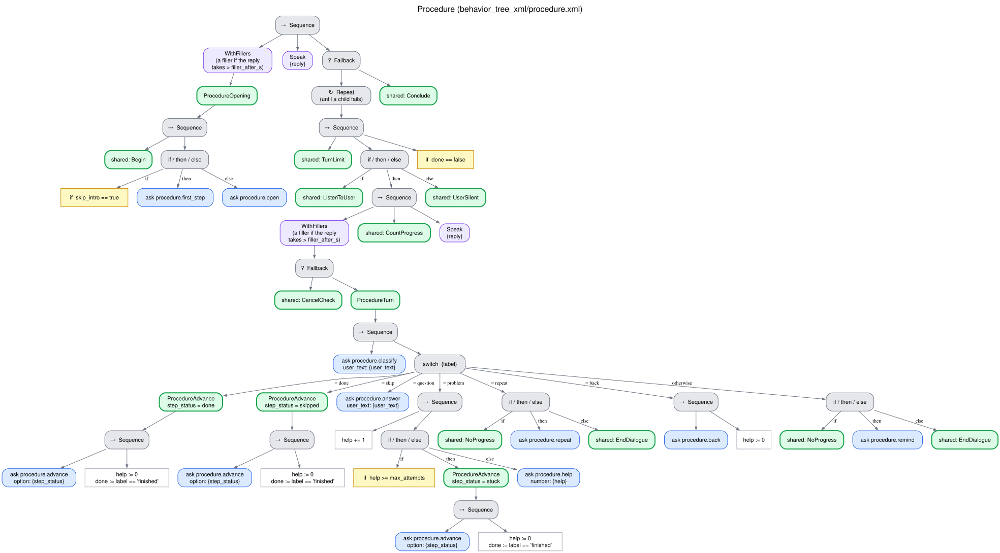

# Procedure (`procedure`)

The robot guides the user through the steps of a procedure one at a time while the user does
them: it waits while a step takes time, answers questions, helps when the user is stuck, repeats,
goes back or skips on request, and sums up at the end. Typical uses: a warm-up routine, measuring
blood pressure, an everyday task. Tree `behavior_tree_xml/procedure.xml`, skills
`interaction_intelligence/skills/procedure.py`. [Index](README.md).

## What it needs and returns

- **Needs:** the steps: the first resource that is a JSON list of steps, each a string or
  `{step, check, duration_s, optional}`:
  - `check`: what the user should observe or report when the step is done (a report that
    contradicts it is a problem, not done);
  - `duration_s`: the seconds the step takes, during which the robot waits in silence without
    prompting ([Silence](silence.md));
  - `optional`: skipping the step does not make the outcome partial.
- **Returns:** `{total_steps, current_step, completed, skipped, results}`, the status of each
  step: `done`, `skipped` or `stuck`.
- **Outcome:** `completed` when every step that is not optional was done; `partial` when one was
  skipped or stuck (the reason lists them).

## How each turn is understood

One question to the LLM (`classify_step_turn`) against the current step:

| The user | Label | The robot | Progress |
|---|---|---|---|
| Reports the step done (consistent with its `check`) | `done` | The next step, or the summary after the last | Yes |
| Wants to skip it | `skip` | The next step (this one skipped) | Yes |
| Asks something | `question` | Answers it | Yes |
| Is stuck, did not understand, or something went wrong | `problem` | Helps; the `max_attempts`-th problem on the same step marks it stuck and the procedure goes on | Yes |
| Asks to hear the step again | `repeat` | Says the step again literally, with fixed phrases and no LLM ("Step n of N: <step>. Tell me when you have done it."), as the other strategies repeat | No |
| Wants to go back | `back` | The previous step again | Yes |
| Anything else | `unclear` | Reminds them to say when the step is done | No |

Each step is phrased for speech by the LLM (`procedure_step`) from that step only. The prompt does
not get the context of the request, because the context holds the whole procedure and small
models merged the next steps into the current one; the prompt also forbids mentioning or joining
other steps.

A reply that reports the step done is `done` even when it also asks something ("It's done. What's
the next step?"): the robot gives the next step and the procedure moves on.

## Tree

## Edge cases

| Situation | What happens |
|---|---|
| Silence during a step with `duration_s` | Waited without prompting, then [Silence](silence.md) |
| Silence | [Silence](silence.md) (the 2nd prompt repeats the step) |
| "Stop" | [Spoken cancellation](cancellation.md) |
| `max_stalled` turns in a row without progress | [Breakdown](no_progress.md): closing line, outcome `breakdown`, the steps so far are returned |
| The LLM fails to classify a turn | `unclear` (a reminder) |
| No steps | `error` before the robot speaks |
| Turn limit, failure of the system | [Endings](endings.md) |

## Parameters

`max_attempts` is the number of problems reported on a step that mark it stuck (the robot helps with
the ones before). The shared limits are described in
[What every behavior shares](README.md#what-every-behavior-shares). Each step can set `duration_s` and
`optional` ([above](#what-it-needs-and-returns)).
