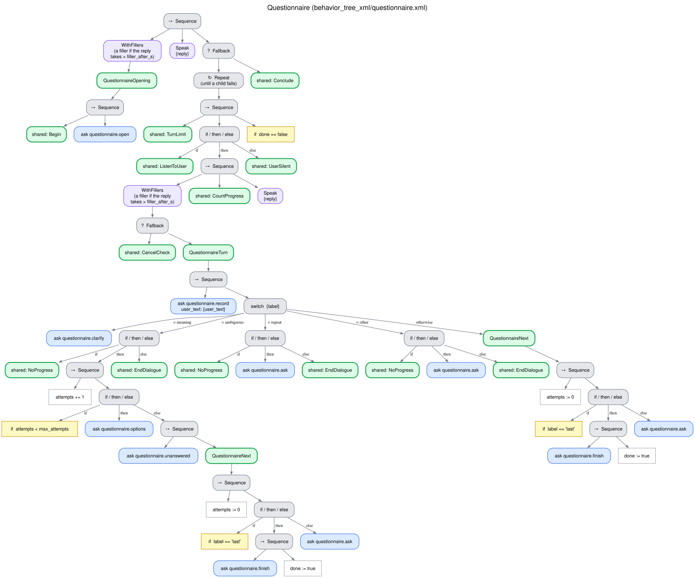

# Standardized questionnaire (`questionnaire`)

The robot administers a questionnaire or a rating scale as it was validated: every item read
word for word, in order, with its answer options; the user's free answer mapped to one of the
options without ever choosing for the user; the score computed by code with the instrument's rule.
Typical uses: a satisfaction survey, a pain rating, a short validated scale. Tree
`behavior_tree_xml/questionnaire.xml`, skills `interaction_intelligence/skills/questionnaire.py`.
[Index](README.md).

## Why it is built this way

The validity of a standardized instrument depends on how it is administered: the same wording, the
same order, the same options, and no suggestion of an answer. An LLM left to administer it tends
to paraphrase the items, suggest answers or miscount the score. The robot therefore reads the items
and the options without the LLM, the LLM only maps the answer to an option, and the score is
arithmetic.

## What it needs and returns

- **Needs:** the instrument, the first resource that is a JSON object with a list `items`:

  ```json
  {"name": "Visitor satisfaction",
   "instructions": "I am going to read you four statements about your visit...",
   "options": ["Not at all", "A little", "Quite", "Very much"],
   "items": ["I enjoyed the visit",
             {"text": "The visit was too long", "reverse": true,
              "clarification": "Too long means that you got tired before the end."}],
   "scoring": "sum"}
  ```

  Options are strings (worth 1 to n, in order) or `{"label", "value"}`; an item can have its own
  options, and every item must have options (its own or the shared ones); `reverse` items are scored
  the other way round; `scoring` is `sum` (default), `mean` or `none`. Without an instrument the
  request fails before the robot speaks.
- **Returns:** `{instrument, answers, answered, score, scoring}`; each answer with the item, its
  status (`answered`, `refused` or `unanswered`), the option chosen, its value and what the user
  said. The robot never says the score.
- **Outcome:** `completed` when every item was answered; `partial` when an item was declined or
  left without an answer (the reason lists them).

## Flow

1. The robot reads the instrument's instructions (or a fixed introduction, if it has none) and the
   first item with its options: "Question 1 of 4: I enjoyed the visit. The options are: Not at all,
   A little, Quite or Very much." The instructions are part of the instrument, so they are read
   even with `skip_intro`.
2. Each answer is mapped to an option in one question to the LLM (`map_scale_answer`).
3. After the last item: "We have finished. Thank you for your answers."

## How each turn is understood

| The user | Label | The robot | Progress |
|---|---|---|---|
| Clearly chooses an option (its words, a synonym or a paraphrase) | `next` / `last` | The next item, or the closing | Yes |
| Declines the item | `next` / `last` | The next item (the item is recorded as refused) | Yes |
| Answers between two options, or with none of them | `ambiguous` | The options again, without suggesting any; after `max_attempts` the item is left without an answer | No |
| Asks what the item or a word means | `meaning` | The instrument's clarification for the item, or the item again | Yes |
| Asks to hear the item again | `repeat` | The item and its options again | No |
| Anything else | `other` | The item and its options again | No |

## Tree



## Edge cases

| Situation | What happens |
|---|---|
| Silence | [Silence](silence.md) (the 2nd prompt repeats the item) |
| "Stop" | [Spoken cancellation](cancellation.md): the answers so far are returned |
| `max_stalled` turns in a row without progress | [Breakdown](no_progress.md) |
| The LLM fails to map an answer | `other`: nothing is recorded for the user; the item is asked again |
| No instrument in the request | `error` before the robot speaks |
| Turn limit, failure of the system | [Endings](endings.md) |

## Parameters

`max_attempts` is the number of answers between options, per item, before the item is left without
an answer. The shared limits are described in
[What every behavior shares](README.md#what-every-behavior-shares). The fixed phrases are
`phrases.questionnaire_intro`, `phrases.questionnaire_item`, `phrases.questionnaire_options`,
`phrases.questionnaire_or` and `phrases.questionnaire_end`
([CONFIGURATION.md](../CONFIGURATION.md#interaction_intelligence)).
