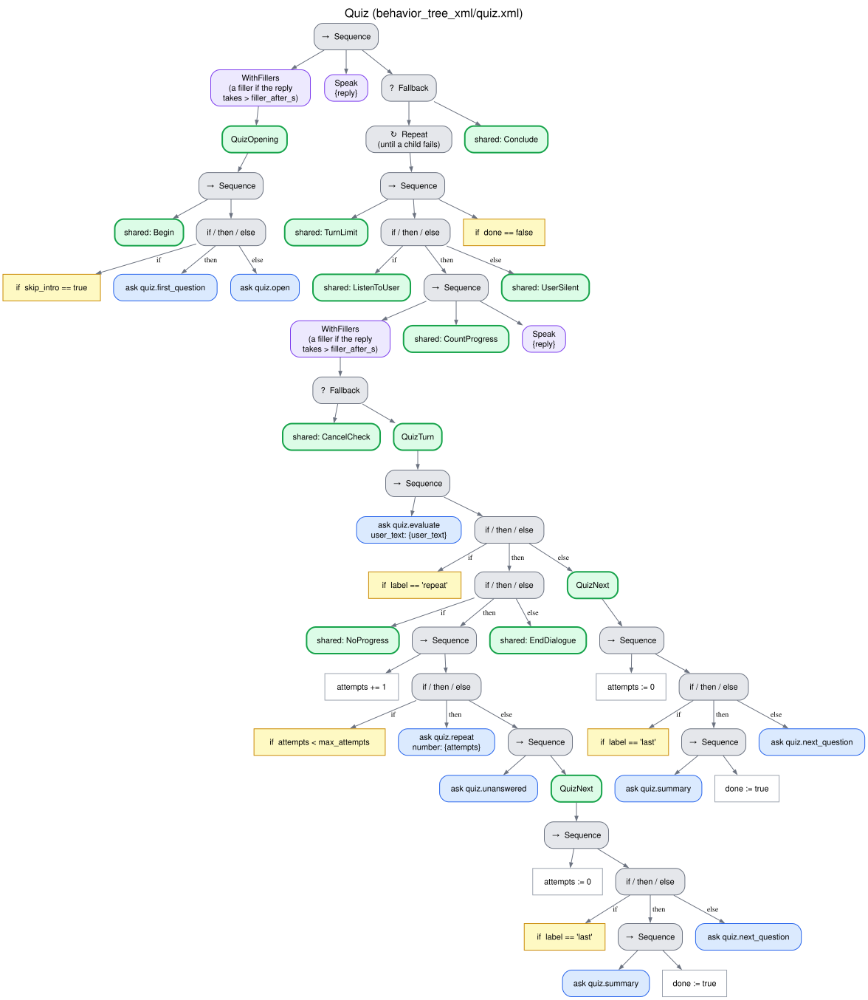

# Quiz (`quiz`)

The robot asks the questions of a bank one at a time, without giving the answer away, grades
each spoken answer against the expected one (accepting synonyms, other wordings and speech
recognition errors), gives short feedback and, after the last question, the score. Typical uses:
memory exercises, reviewing content. Tree `behavior_tree_xml/quiz.xml`, skills
`interaction_intelligence/skills/quiz.py`. [Index](README.md).

## What it needs and returns

- **Needs:** a question bank: the first resource that is a JSON list of `{question, answer}`.
  Without it the request fails before the robot speaks.
- **Returns:** `{total_questions, current_question, correct_answers, unanswered, results}`; each
  result has the question, the expected and the given answer, `correct` and `answered`.
- **Outcome:** `completed` when every question was answered (whatever the score); `partial` when
  some question was left unanswered (the reason lists them).

## How each turn is understood

One question to the LLM (`evaluate_quiz_answer`) decides whether the reply is an answer and, if
it is, whether it is correct:

| The user | The robot | Progress |
|---|---|---|
| Answers (right or wrong; "I don't know" is an answer) | Feedback and the next question, or the score after the last | Yes |
| Asks to repeat or clarify, says they did not hear or understand the question | 1st time: the question again, literally (no LLM). 2nd time: in simpler words, without revealing the answer. At `max_attempts`: "We'll leave that one unanswered." and the next question | No |

A question left unanswered is not graded as wrong: the score counts only the answers. The
attempts restart with each question.

## Tree

## Edge cases

| Situation | What happens |
|---|---|
| Silence | [Silence](silence.md) (the 2nd prompt repeats the question) |
| "Stop" | [Spoken cancellation](cancellation.md) |
| `max_stalled` replies in a row that are not answers | [Breakdown](no_progress.md): closing line, outcome `breakdown`, the answers so far are returned |
| The LLM fails to grade | Retried; if it still fails, graded by exact match (below) |
| The LLM fails to simplify a question | The question itself |
| No question bank | `error` before the robot speaks |
| Turn limit, failure of the system | [Endings](endings.md) |

When the LLM keeps failing to grade, the reply is graded right only if it is the expected answer
itself, after normalization. The answer is never searched for inside a longer reply, where
"Mercury... no, lead" would pass as "Mercury": rejecting a right answer is a safer error than
accepting a wrong one.

## Parameters

`max_attempts` is the number of replies to a question that are not answers before it is left
unanswered. The shared limits are described in
[What every behavior shares](README.md#what-every-behavior-shares). The fixed phrases are
`phrases.quiz_correct`, `phrases.quiz_wrong` and `phrases.quiz_unanswered`
([CONFIGURATION.md](../CONFIGURATION.md#interaction_intelligence)).
