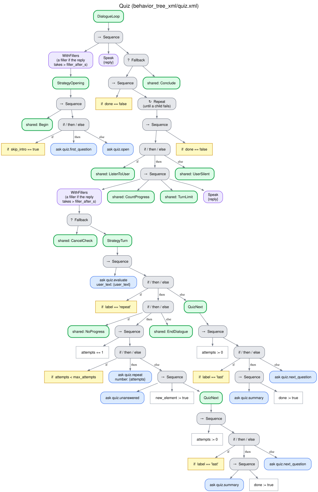

# Quiz (`quiz`)

The robot asks the questions of a bank one at a time, without giving the answer away, grades
each spoken answer against the expected one (accepting synonyms, other wordings and speech
recognition errors), gives short feedback and, after the last question, the score. Typical uses:
memory exercises, reviewing content. Tree `behavior_tree_xml/quiz.xml`, skills
`interaction_intelligence/skills/quiz.py`. [Index](README.md).

## What it needs and returns

- **Needs:** a question bank: the first resource that is a JSON list of `{question, answer}`.
  Without it the request fails before the robot speaks.
- **Returns:** `{total_questions, current_question, correct_answers, unanswered, results}`; each
  result has the question, the expected and the given answer, `correct` and `answered`.
- **Outcome:** `completed` when every question was answered (whatever the score); `partial` when
  some question was left unanswered (the reason lists them).

## How each turn is understood

One question to the LLM (`evaluate_quiz_answer`) decides whether the reply is an answer and, if
it is, whether it is correct:

| The user | The robot | Progress |
|---|---|---|
| Answers (right or wrong; "I don't know" is an answer) | Feedback and the next question, or the score after the last | Yes |
| Asks to repeat or clarify, says they did not hear or understand the question | 1st time: the question again, literally (no LLM). 2nd time: in simpler words, without revealing the answer. At `max_attempts`: "We'll leave that one unanswered." and the next question | No |

A question left unanswered is not graded as wrong: the score counts only the answers. The
attempts restart with each question. A tentative answer said as a question or with doubt ("Is it
Rome?", "maybe Paris?") is an answer, graded on what it names.

**Numeric answers.** The LLM first decides whether the reply is an answer or a request to hear the
question again, also for a numeric question: "one more time", "una vez más" or "can you say
question two again?" say a number but are not answers. When the expected answer is a single
number, an answer is then graded by the number it says, not by the LLM's grade, if it says
exactly one number, in digits or in words ("forty-eight", "cuarenta y ocho",
"two thousand and five", "mil novecientos sesenta y nueve"). The numbers that the question itself
says do not count: in "How many hours are there in two days?", "Two days have forty-eight hours"
is graded on 48. The articles "a", "un", "una" and the word "one" count as 1 only when the reply
has no other number ("Mars has one moon") or come before a multiplier ("a hundred"). A reply
with no number, or with several ("forty-eight or fifty"), keeps the LLM's grade. Small models
accepted near misses ("forty" for 48), and a comparison of numbers does not need a model; the
call that tells an answer from a request to repeat is made for every reply.
The feedback is then the fixed phrase (`phrases.quiz_correct` or `phrases.quiz_wrong`).

An answer that does not state a number and that the LLM grades as wrong is graded correct when it
names the whole expected answer, word for word, with none of the language's `negation_words` or
`hedge_words` in it (`utils.local_names_answer`; a leading article of the expected answer is not
required). "A young to is all a tadpole." is right for "A tadpole"; "Not a tadpole, a froglet.",
"A frog or a tadpole?" and "Maybe a tadpole" keep the LLM's grade. A speech recognizer that
garbles the words around an answer often leaves the answer itself intact, and the LLM, which sees
only this line, read the garbled words as a wrong answer. A grade of correct is never changed.

## Tree

## Edge cases

| Situation | What happens |
|---|---|
| Silence | [Silence](silence.md) (the 2nd prompt repeats the question) |
| "Stop" | [Spoken cancellation](cancellation.md) |
| `max_stalled` replies in a row that are not answers | [Breakdown](no_progress.md): closing line, outcome `breakdown`, the answers so far are returned |
| The LLM fails to grade | Retried; if it still fails, graded by exact match (below), and then right also when the reply names the whole expected answer with no negation or hedge word |
| The LLM fails to simplify a question | The question itself |
| No question bank | `error` before the robot speaks |
| Turn limit, failure of the system | [Endings](endings.md) |

When the LLM keeps failing to grade, the reply is graded right only if it is the expected answer
itself, after normalization. The answer is never searched for inside a longer reply, where
"Mercury... no, lead" would pass as "Mercury": rejecting a right answer is a safer error than
accepting a wrong one.

## Parameters

`max_attempts` is the number of replies to a question that are not answers before it is left
unanswered. The shared limits are described in
[What every behavior shares](README.md#what-every-behavior-shares). The fixed phrases are
`phrases.quiz_correct`, `phrases.quiz_wrong` and `phrases.quiz_unanswered`
([CONFIGURATION.md](../CONFIGURATION.md#interaction_intelligence)).
