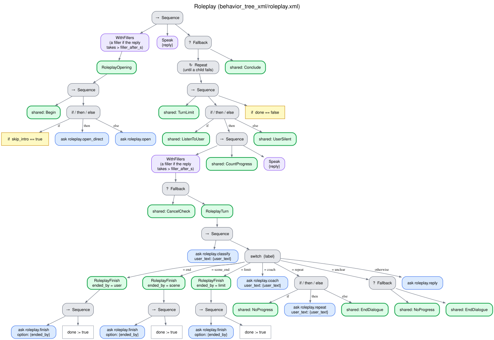

# Role play (`roleplay`)

The robot plays a character in a scene so that the user can practice a situation (a job
interview, a conversation in another language), gives hints out of character on request, and at
the end steps out of the role and scores the user from 1 to 5 on each criterion of a rubric,
citing the user's own lines as evidence, with feedback. Tree `behavior_tree_xml/roleplay.xml`,
skills `interaction_intelligence/skills/roleplay.py`. [Index](README.md).

## What it needs and returns

- **Needs:** the scene, the first resource that is a JSON object
  `{scenario, role, criteria: [...]}`, with the optional fields `user_goal` (what the user
  practices) and `max_exchanges`. A criterion is a string or `{name}`; at least one is required.
  `max_exchanges` is the number of user lines in the scene, 10 by default and at least 6
  (`MIN_EXCHANGES`), so that the user has room to show every criterion; hints and requests to
  repeat do not count.
- **Returns:** `{scenario, role, exchanges, max_exchanges, ended_by, scores, average, highlight,
  improve}`: each score with its criterion, the score, the evidence (the user's own lines) and a
  comment; who ended the scene (`ended_by`: `user`, `scene` or `limit`); and the feedback.
- **Outcome:** `completed` once the scene was evaluated on every criterion, whether the user, the
  scene or the limit ended it; `partial` when the evaluation could not score some criterion (the
  LLM failed), with `Criteria not scored: ...` as the reason and the scores it did give, as other
  strategies do when an element is left unfinished. A cancellation gives `cancelled`, and a
  breakdown is not evaluated ([below](#edge-cases)).

The scene is hidden from the context of the other questions, so the character never sees the
rubric.

## How each turn is understood

One question to the LLM (`classify_roleplay_turn`):

| The user | Label | The robot |
|---|---|---|
| A line of the scene | `continue` | The character replies (a line that repeats an earlier question is asked again once) |
| Did not hear or understand the character's last line, or asks to hear it again | `repeat` | The first time, the character's last line literally (no LLM, the request kept out of the scene's transcript); after that, the character says it again in different words. A turn without progress |
| Asks for help | `coach` | A hint out of character, kept out of the scene's transcript |
| Wants to stop the practice | `end` | Steps out of the role and evaluates |
| The scene reached its natural end | `scene_end` | Steps out of the role and evaluates |
| — (the last exchange allowed: `max_exchanges`, capped by `max_turns`) | `limit` | Steps out of the role and evaluates |
| — (the LLM gives no valid reading: no answer, or not what was asked) | `unclear` | Asks to repeat with a fixed phrase ("Could you repeat that?"), out of character; the line is kept out of the scene's transcript. A turn without progress |

Only `continue` turns count as exchanges: a hint, a request to repeat or a turn not understood
does not use up the scene. Every line of the scene makes progress; requests to repeat and turns
not understood do not, so `max_stalled` of them in a row end the dialogue with a
[breakdown](no_progress.md). An LLM that is down therefore ends a role play with a breakdown, as
in every other strategy, instead of letting the scene run to its limit and close without scores.
The exchange limit is capped by the request's turn limit so that the user always gets the
evaluation.

Before the scene, the robot introduces it out of character (`roleplay_intro`): the situation, the
role it plays (named only: not how the character behaves or what it will ask, which would give
away the rubric) and that the user plays themself, never the other way round; then how to ask for
a hint and to finish.

## Tree

## Edge cases

| Situation | What happens |
|---|---|
| Silence | [Silence](silence.md) |
| `max_stalled` requests to repeat or turns not understood in a row | [Breakdown](no_progress.md): closing line, outcome `breakdown`, no evaluation |
| "Stop" (spoken cancellation) | [Spoken cancellation](cancellation.md); then the evaluation of the exchanges so far, outcome `cancelled` (below) |
| The LLM fails to classify a turn | `unclear`: the robot asks to repeat, a turn without progress; a sustained failure ends as a breakdown |
| The LLM fails to evaluate the scene (some or every criterion) | The feedback says the scores obtained (or only the fixed closing phrase); outcome `partial`, `Criteria not scored: ...` |
| The LLM fails to generate a line | A fixed phrase of the language (the character's: "Go on, I'm listening.") |
| A scene without criteria | `error` before the robot speaks |
| Turn limit, failure of the system | [Endings](endings.md) |

Once a cancellation is confirmed, or made at once because the LLM is down, stopping and finishing
lead to the same place, so that a user who stops still gets the evaluation of what was done. When
the user has said at least one line of the scene, the robot steps out of the role and evaluates
the exchanges so far: the feedback and the scores, with `ended_by` `user`, go in
`final_frame_json`, and the outcome is `cancelled` by the user. Before the first line there is
nothing to score, so the robot says the cancel closing; it does the same when no criterion can be
scored because the LLM fails. "I want to stop the practice" said inside the scene is `end`: the
scene is evaluated and the outcome is the scene's. The English introduction tells the user to say
"finish" rather than "stop", which is an exact stop command, so that ending the practice leads
straight to the evaluation without the confirmation question.

## Parameters

`max_exchanges` is a field of the scene ([above](#what-it-needs-and-returns)). The shared limits
are described in [What every behavior shares](README.md#what-every-behavior-shares).
