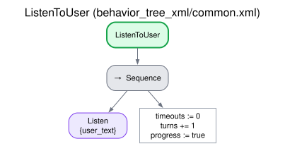
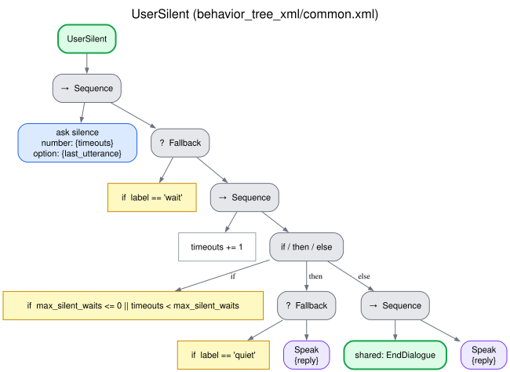

# Silence

Silence is not abandonment: a person may be thinking about an answer, looking for a piece of
data, or doing what the robot asked. The robot waits, says from time to time that it is still
there, repeats what it had asked in case it was not heard, and only after a long silence closes
the conversation, saying so.

Shared by every dialogue behavior: subtrees `ListenToUser` and `UserSilent` of `common.xml`, skill
`silence` (`interaction_intelligence/skills/common.py`). [Index](README.md).

## How it works

`Listen` waits `wait_timeout` seconds for the user. If nothing comes, `UserSilent` asks the
`silence` skill what to do with this wait and counts it (`timeouts`, the waits in a row; any
utterance of the user resets it):

| Wait in a row | The robot | Counts |
|---|---|---|
| During a step that takes time (procedure, `duration_s`) | Says nothing | No |
| 1st | "Take your time, I'm still here." | Yes |
| 2nd | Repeats what it had asked (its last utterance before the silence) | Yes |
| 3rd, 5th, ... | Says nothing | Yes |
| 4th, 6th, ... | "Whenever you're ready, I'm here." | Yes |
| The one that reaches `max_silence` | The closing line "Let's leave it here. We can pick it up whenever you like." and the dialogue ends: outcome `user_silent` | |

The phrases are fixed, not generated: immediate and predictable, and the same whether or not the
LLM works. They follow the language of the conversation (its language file,
[ADDING_A_LANGUAGE.md](../ADDING_A_LANGUAGE.md)) and can be edited in the GUI's Strategies page
(the phrases `timeout`, `silence_ready` and `close_user_silent`).

The orchestrator converts `max_silence` into a number of waits,
`max_silent_waits = max(1, ceil(max_silence / wait_timeout))`. With `wait_timeout` 15 s and
`max_silence` 90 s, the robot speaks at 15, 30 and 60 seconds, stays quiet at 45 and 75, and
closes at 90.

### A step that takes time

A procedure step may declare its duration (`duration_s`, e.g. 60 s to measure blood
pressure). While that time has not passed, a silence is the user doing the step: the robot says
nothing and the wait does not count. Once it has passed, the cycle above starts. The time waited
on a step restarts when the step changes. Other behaviors have no such grace (the hook is
`DialogueMode.silence_grace`, for new behaviors).

## Trees

## Edge cases

| Situation | What happens |
|---|---|
| The user speaks during the waits | It is a normal turn: the silence count restarts |
| The user says only a filler word ("hmm", "eh") or a recurrent hallucination of the recognizer ("Thanks for watching!") | The intelligence drops it as noise, so for the dialogue it is silence (below) |
| The silence reaches `max_silence` | Closing line, outcome `user_silent`, reason "The user stayed silent for max_silence seconds" |
| `max_silence` is 0 | The dialogue never ends on silence; the prompts go on |
| The intelligence does not answer the `silence` skill | A failure of the system: the error closing line, outcome `error` ([Endings](endings.md)) |
| Speech-to-text is not available | Every wait ends empty: the prompts follow, and the conversation ends as `user_silent` |

Only a whole utterance made of noise phrases (`asr_noise_phrases` of the language files) is
dropped. A noise phrase inside real words ("Eh, para.", "No olvides la leche") leaves a normal
turn, unchanged, because discarding the utterance would lose what the user said.

## Parameters

`wait_timeout` and `max_silence` are parameters of the orchestrator
([CONFIGURATION.md](../CONFIGURATION.md#interaction_orchestrator)); a request can set its own
`wait_timeout` and `max_silence` ([ROS_INTERFACES.md](../ROS_INTERFACES.md#dialogtask-goal)). The
phrases are `phrases.timeout`, `phrases.silence_ready` and `phrases.close_user_silent` of the
intelligence (`timeout_prompt` also sets the first one,
[CONFIGURATION.md](../CONFIGURATION.md#interaction_intelligence)); `duration_s` is a field of a
procedure step ([Procedure](procedure.md#what-it-needs-and-returns)).
