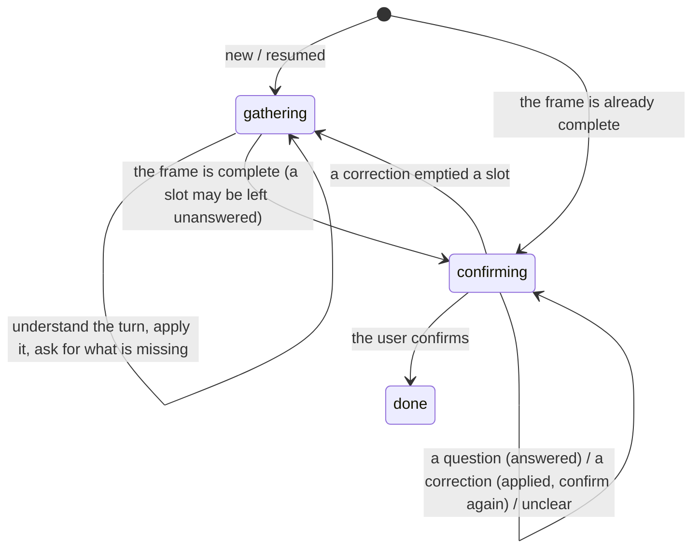
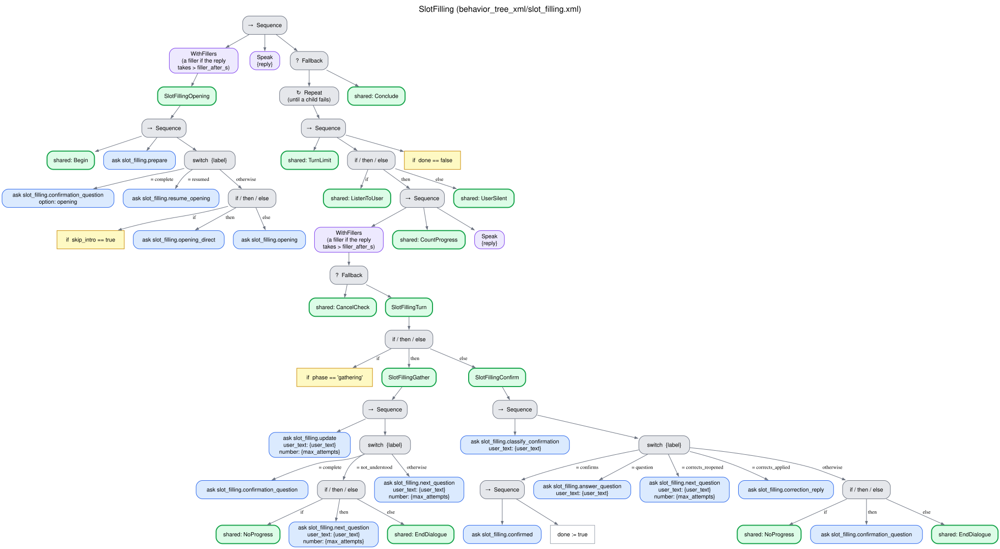

# Slot filling (`slot_filling`)

The robot collects the data a task needs (the *slots* of a frame), accepts corrections and
several values in one turn, validates types, allowed values, ranges and conditions, and reads the
data back for an explicit confirmation before closing. Typical uses: taking an order, a booking,
registering a visitor. Tree `behavior_tree_xml/slot_filling.xml`, skills
`interaction_intelligence/skills/slot_filling.py`, the frame `dialog_frame.py`. [Index](README.md).

## What it needs and returns

- **Needs:** nothing. A slot schema (`frame_schema_json`, [SLOT_SCHEMA.md](../SLOT_SCHEMA.md)) is
  optional: without it the LLM designs the slots from the task and audits their allowed values
  against the resources. `initial_frame_json` pre-fills values (to resume).
- **Returns** (`final_frame_json`): the frame, the filled slots as a JSON object.
- **Outcome:** `completed` when the user confirmed the data and every slot was filled; `partial`
  when they confirmed it with some slot left unanswered (`Unanswered slots: ...`); the shared
  endings in [Endings and outcome](endings.md).

## Flow

1. **Opening.** The frame is built; the robot asks for the first missing slot, or resumes, or,
   if the frame is already complete, asks for confirmation.
2. **Gathering.** Each turn is understood in one question to the LLM (`extract_slots`): the
   values it gives or corrects, and what the turn does. The frame applies the values
   (deterministic: types, allowed values, ranges, conditional slots, list operations). A
   conditional slot that does not apply yet is also offered to the LLM, marked with its condition,
   so that it can come in the same turn as the value that makes it apply ("a latte with oat
   milk"); the frame keeps it only if its condition holds once the whole turn is applied ("an
   espresso with oat milk" keeps no milk). The robot
   acknowledges what was applied (a fixed phrase, never the LLM's, so it never acknowledges what
   it did not get) and asks for what is missing. Only a question for a list slot says that several
   values may be given: the code adds that instruction to the prompt when the slot asked is a list
   (`list_str`), never for a single-value slot. Every question speaks to the user directly ("what
   is your name?", not "the customer's name") and informally ([PROMPTS.md](../PROMPTS.md#placeholders-context-and-caching)).
3. **Confirming.** When no slot is missing, the robot reads the frame back, saying which slots
   were left blank, and asks for a yes or no.

## How each turn is understood

| Phase | What the user does | The robot | Progress |
|---|---|---|---|
| Gathering | Gives or corrects values | Acknowledges, asks for the next slot (or confirms if complete) | Yes |
| Gathering | A value out of range | Says it was not recorded and why, asks again | Yes |
| Gathering | Asks something (options, prices, what was collected) | Answers from the resources only, or says it does not know; asks for the slot | Yes |
| Gathering | "I don't know", "I'd rather not say", "skip it" | Leaves the slot **unanswered** ("Alright, we'll leave that one blank.") and goes on | Yes |
| Gathering | Asks to repeat, or something not understood | Asks again ([recovery](no_progress.md)) | No |
| Confirming | Confirms | Closes, never with a question (a closing from the model that asks something is replaced by the fixed `confirmed_closing`) | Yes |
| Confirming | Asks a question | Answers it | Yes |
| Confirming | Corrects a value | Applies it and confirms again (or gathers again if a slot became empty) | Yes |
| Confirming | Unclear | Asks for the confirmation again | No |

A slot asked `max_attempts` times without being filled is asked differently (a simpler closed
question); after one more failed attempt it is left unanswered. A question of the user does not
count as a failed attempt. Slots conditioned on an unanswered slot are not asked (their
condition cannot hold). If the user gives an unanswered value later, it is recorded.

**Provisional changes (provisional, 2026-11-01, after the third debugging round; to be confirmed by the author).** A value of a closed slot (canonical values) is taken only
when the user's words contain it (a word of three or more letters, or a number): the model must not
pick a value from the list for words that say nothing of it. A correction that applied nothing (an
unreadable one) is read again by the extraction of the gathering phase. After a correction the
robot reads the frame back as it is recorded (an acknowledgment and the confirmation question), not
a free sentence about the correction.

## Tree

## Eventualities

| Situation | What happens |
|---|---|
| Silence | [Silence](silence.md) |
| "Stop" | [Spoken cancellation](cancellation.md); while a closed-choice slot is being asked, only an explicit request to stop cancels (strict mode), not a cancel-like word inside an answer |
| `max_stalled` turns without progress | [Breakdown](no_progress.md): closing line, outcome `breakdown`, the slots filled so far are returned |
| The LLM fails extracting a turn | The turn is not understood (no value) |
| The LLM fails designing the frame (no schema) | `error` before the robot speaks |
| An invalid schema | `error` before the robot speaks, with the reason |
| Turn limit, failure of the system | [Endings](endings.md) |

## Parameters

`max_attempts` is the number of failed askings of a slot before it is asked differently. The limits
are parameters of the orchestrator
([CONFIGURATION.md](../CONFIGURATION.md#interaction_orchestrator)); `max_turns`, `max_silence` and
`max_stalled` can also be set per request
([ROS_INTERFACES.md](../ROS_INTERFACES.md#dialogtask-goal)). The acknowledgments are `ack_phrases`
and `ack_enabled`, and the line for a slot left blank is `phrases.slot_skipped`
([CONFIGURATION.md](../CONFIGURATION.md#interaction_intelligence)).
