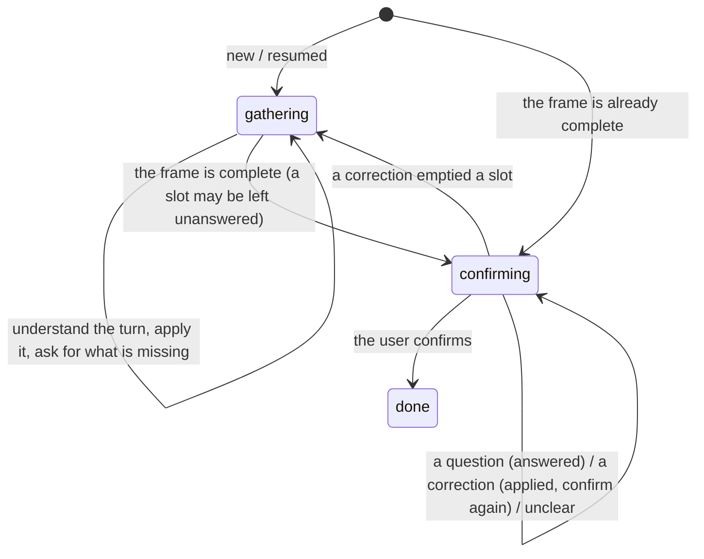
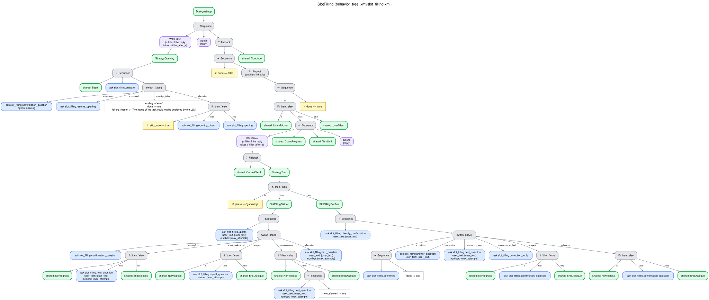

# Slot filling (`slot_filling`)

The robot collects the data a task needs (the *slots* of a frame), accepts corrections and
several values in one turn, validates types, allowed values, ranges and conditions, and reads the
data back for an explicit confirmation before closing. Typical uses: taking an order, a booking,
registering a visitor. Tree `behavior_tree_xml/slot_filling.xml`, skills
`interaction_intelligence/skills/slot_filling.py`, the frame `dialog_frame.py`. [Index](README.md).

## What it needs and returns

- **Needs:** nothing. A slot schema (`frame_schema_json`, [SLOT_SCHEMA.md](../SLOT_SCHEMA.md)) is
  optional: without it the LLM designs the slots from the task and audits their allowed values
  against the resources. `initial_frame_json` pre-fills values (to resume).
- **Returns** (`final_frame_json`): the frame, the filled slots as a JSON object.
- **Outcome:** `completed` when the user confirmed the data and every slot was filled; `partial`
  when they confirmed it with some slot left unanswered (`Unanswered slots: ...`); the shared
  endings in [Endings and outcome](endings.md).

## Flow

1. **Opening.** The frame is built; the robot asks for the first missing slot, or resumes, or,
   if the frame is already complete, asks for confirmation.
2. **Gathering.** Each turn is understood in one question to the LLM (`extract_slots`): the
   values it gives or corrects, and what the turn does. The frame applies the values
   deterministically, checking types, allowed values, ranges, conditional slots and list
   operations. A conditional slot that does not apply yet is also offered to the LLM, marked
   with its condition, so that it can come in the same turn as the value that makes it apply ("a
   latte with oat milk"); the frame keeps it only if its condition holds once the whole turn is
   applied ("an espresso with oat milk" keeps no milk). The robot acknowledges what was applied
   with a fixed phrase, never a generated one, so that it never acknowledges a value it did not
   get, and asks for what is missing. Only a question for a list slot (`list_str`) says that
   several values may be given: the code adds that instruction to the prompt for list slots
   only. Every question speaks to the user directly ("what is your name?", not "the customer's
   name") and informally ([PROMPTS.md](../PROMPTS.md#placeholders-context-and-caching)).
3. **Confirming.** When no slot is missing, the robot reads the frame back, saying which slots
   were left blank, and asks for a yes or no. The generated read-back is checked against the
   frame: if it leaves a value out, or says a number that no value has (an added time or price),
   or the model failed, the robot says instead the read-back built by code ("Let me check: Ana,
   latte, large. Is that right?", `readback`). A reply to the read-back that opens with a yes
   ("Yes, that's correct.") is the confirmation, never a request to stop, even when the data
   speak of cancelling ("cancel a card"): see [Cancellation](cancellation.md#edge-cases). A free-text value is stored without the short
   words that never end a value said on its own ("Marta the" is "Marta"; `trailing_words` of the
   language file).

## How each turn is understood

| Phase | What the user does | The robot | Progress |
|---|---|---|---|
| Gathering | Gives or corrects values | Acknowledges, asks for the next slot (or confirms if complete) | Yes |
| Gathering | A value out of range | Says the value is not possible and the allowed range, built by code from the schema so that no bound is left out ("200 is not possible: it must be between 18 and 120."), then asks again | Yes |
| Gathering | Asks something (options, prices, what was collected) | Answers from the resources only, or says it does not know; asks for the slot | Yes |
| Gathering | "I don't know", "I'd rather not say", "skip it" | Leaves the slot unanswered ("Alright, we'll leave that one blank.") and goes on | Yes |
| Gathering | Asks to hear the question again | A ladder per slot: the question again as it was said, then in simpler words, then the options of a closed slot ("Is it coffee or tea?", by code) or simpler words with an example of the kind of answer; the count starts again with every turn with progress. It is never a failed attempt on the slot | No |
| Gathering | Something not understood, also the turn that leaves the slot unanswered at its `max_attempts`-th failed attempt (the next slot is then a new element: its first turn without progress never ends the conversation) | Asks again ([recovery](no_progress.md)). A line that does not make sense (a garbled transcription) is not understood: it gives no value, not even to a free-text slot such as a name | No |
| Confirming | Says no, or that something is wrong, without a new value the robot can read | Unclear: never a confirmation (a reply that starts with a no word of the language file is never read as one) | No |
| Confirming | Confirms, naming a value of a closed slot that the data read back do not have ("Yes, free swim and aquagym" when only free swim was read back) | A correction of that value: added to a list slot, or the new value of a one-value slot when the reply names only that one; then confirms again. A value with a word of the language's `denial_words` among the three words before it ("not the sauna") is not counted; free text and numbers are left to the model. Reason: the model read such replies as a plain yes about half the time, and the wrong data were confirmed | Yes |
| Confirming | Confirms | Closes, never with a question (a generated closing that asks something is replaced by the fixed `confirmed_closing`) | Yes |
| Confirming | Asks a question | Answers it, then asks for the confirmation again with a fixed yes/no question (`confirm_again`), so that an "okay" to the answer is not taken as a confirmation of the data | Yes |
| Confirming | Corrects a value | Applies it and confirms again (or gathers again if a slot became empty). A list slot takes several changes at once ("take out the olives and put mushrooms": both applied, the removal first) | Yes |
| Confirming | Asks to hear the data again | Reads the data back again, with the question | No |
| Confirming | Unclear | Asks for the confirmation again | No |

A failed attempt is a turn that gives no value at all and asks no question; an answer about
another slot is not a failed attempt on the slot asked. The last asking of a slot (after
`max_attempts` - 1 failed attempts) is different (the options of a closed slot, below), and at `max_attempts` failed attempts the slot
is left unanswered: with the default 3, the slot is asked three times in all. A question from the
user does not count as a failed attempt. Slots conditioned on an unanswered slot are not asked (their
condition cannot hold). If the user later gives a value for an unanswered slot, it is recorded.

A closed slot (one with `canonical_values`) takes a value only when the user's words point to it,
so that the LLM cannot pick a value from the list for words that do not mention it. The words
point to a value when the user says it; says its numbers, also in words ("six in the evening" or
"six" for `18:00`, "two" for `2`); or says a word that only that value has. A word that several
values share ("a car" for `car rental` and `car wash`), or a time that fits several values, is
ambiguous: nothing is taken and the robot reads the options again ("Is it car rental or car
wash?"). An answer between values, which does not settle on one ("about 3, or 4" when the
values are 2, 4 and 6; "between morning and afternoon"), takes no value either: the extraction
says so (act `between`), and so does the code when the user says two or more values in full with
a hedge word (`hedge_words` of the language file: "or", "between", "maybe") and no "no", which
would mark a correction. It counts as a failed attempt on the slot, and the robot reads the
options, composed by code (`slot_between`: "I need one of these: 2, 4 or 6."). The questionnaire
does the same with an answer between two options. The robot also takes a value when the user says yes to a question that named only that
value ("Is it 18:00?" "Yes."), and when the user picks one by its position just after the robot
read the options ("the second one", "la última"; the ordinal words of the language file). The
last asking of a closed slot is that question with the options, composed by code (`slot_options`,
"Is it coffee or tea?"); an open slot is asked in simpler words, with an example of the kind of
answer, never with a yes/no question that proposes a value. A correction that applied nothing
because it could not be read is read again by the extraction of the gathering phase. After a
correction, the robot reads the frame back as it is recorded (an acknowledgment and the
confirmation question), not a free sentence about the correction.

## Tree

## Edge cases

| Situation | What happens |
|---|---|
| Silence | [Silence](silence.md) |
| "Stop" | [Spoken cancellation](cancellation.md); while a closed-choice slot is being asked, only an explicit request to stop cancels (strict mode), not a cancel-like word inside an answer |
| `max_stalled` turns without progress | [Breakdown](no_progress.md): closing line, outcome `breakdown`, the slots filled so far are returned |
| The LLM fails to extract a turn | The turn is not understood (no value) |
| The LLM fails to design the frame (no schema) | The robot says the closing line of an error ("I'm sorry, something went wrong and I have to stop here."), and the dialogue ends with the outcome `error` and the reason "The frame of the task could not be designed by the LLM" |
| An invalid schema | `error` before the robot speaks, with the reason |
| Turn limit, failure of the system | [Endings](endings.md) |

## Parameters

`max_attempts` is the number of failed attempts that leave a slot unanswered (the last asking
before it is different). The
shared limits are described in [What every behavior shares](README.md#what-every-behavior-shares).
The acknowledgments are `ack_phrases` and `ack_enabled` (per request, `acknowledgments`), and the
line for a slot left blank is `phrases.slot_skipped`
([CONFIGURATION.md](../CONFIGURATION.md#interaction_intelligence)).
