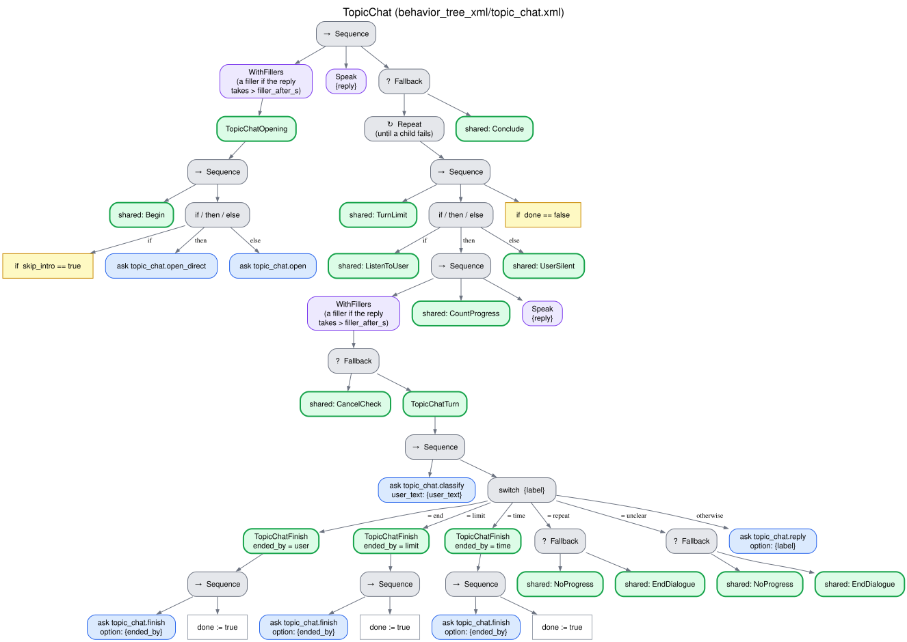

# Topic-bounded social conversation (`topic_chat`)

The robot talks with the user about a topic set by the requester, with nothing to collect, explain
or test: "your village in the sixties", "the photograph of your wedding", "the work you did". The
typical uses are companionship and reminiscence sessions with older people. The robot keeps the
initiative: each of its lines comments on what the user said and ends with one open question on
the topic. When the user drifts away, the robot bridges back gently; it does not go into the
topics it is told to avoid; and at the limit it closes with a short summary of what the user
shared and a goodbye, not with an abrupt end. Tree `behavior_tree_xml/topic_chat.xml`, skills
`interaction_intelligence/skills/topic_chat.py`. [Index](README.md).

## Why it is built this way

A conversation without a task result is where an LLM is freest: it can follow the user anywhere,
fill silences with facts of its own, or close the conversation when it runs out of things to say.
The behavior keeps what the LLM decides narrow. One question reads each turn (on the topic,
drifting, a topic to avoid, an end, a request to repeat); the tree decides what follows; and the
generated line only phrases a reply of the kind the tree chose. The limit, the closing, the topics
to avoid and what the robot may say about the person are fixed by the request, not by the model.
Telling a memory is the user's part: the robot listens, asks, and never corrects the user's
memories nor states facts about the person that the user did not say and that are not in the
material.

## What it needs and returns

- **Needs:** the topic, the first resource that is a JSON object with `topic`. Optional fields:
  `material` (a text or a list of texts: the description of a photograph, facts given by the
  family or the staff), `questions` (supporting questions the robot may bring in when a thread
  runs out), `avoid` (topics the robot does not go into), `max_exchanges` (user turns on the
  topic: 12 by default, at least 3, `MIN_EXCHANGES`) and `max_minutes` (since the opening; none by
  default). Whichever limit comes first ends the conversation. The topic resource is hidden from
  the context of the other questions: each prompt gets the parts it needs.
- **Returns:** `{topic, exchanges, max_exchanges, duration_s, ended_by, covered,
  questions_covered, questions_not_covered, topics, drifts, avoided}`: the duration in seconds,
  who or what ended the conversation (`ended_by`: `user`, `limit` or `time`), the supporting
  questions the user talked about (their numbers, and their texts) and those not covered, the
  topics that came up, and how many turns drifted away or brought up a topic to avoid.
- **Outcome:** `completed` when the conversation closes normally, at the limit or when the user
  ends it, also when they ask to stop. A breakdown gives `breakdown`, as in every behavior
  ([below](#edge-cases)).

The covered supporting questions and the topics are read once, after the closing, from the whole
conversation (`review_topic_chat`), so that the question asked on every turn stays narrow.

## How each turn is understood

One question to the LLM (`classify_topic_turn`), asked after the [urgencies and the spoken
cancellation](cancellation.md):

| The user | Label | The robot |
|---|---|---|
| Talks about the topic, or about something it brought up (a memory, a person, a feeling, an answer, a question on it, a short reaction) | `on_topic` | Comments on what the user said and asks one open question on the topic |
| Moves to something with no connection to the topic | `drifting` | Acknowledges it in a few words and bridges back to the topic through something in common, never abruptly |
| Brings up a topic to avoid | `avoid` | Does not go into it, comment on it or name it: acknowledges the user kindly and moves to another side of the topic |
| Wants to end the conversation, or says goodbye | `end` | The closing: a summary and a goodbye |
| Did not hear or understand the robot's last line | `repeat` | The robot's last line again, literally, without the LLM. A turn without progress |
| — (the turn that reaches `max_exchanges`, capped by `max_turns`, or `max_minutes`) | `limit`, `time` | The closing |
| — (the LLM gives no valid reading) | `unclear` | Asks to repeat with a fixed phrase ("Could you repeat that?"); the line is kept out of the conversation. A turn without progress |

When the LLM hesitates between `on_topic` and another kind, it is told to choose `on_topic`: a
loosely connected memory is part of the conversation, and bridging back from it would cut the user
short. Only the turns on the topic, drifting or on a topic to avoid count as exchanges; a request
to repeat and a turn not understood do not, and `max_stalled` of them in a row end the
conversation with a [breakdown](no_progress.md). The exchange limit is capped by the request's
turn limit, so that the user always gets the closing.

The robot's line (`topic_chat_reply`) sees the topic, the material, the supporting questions, the
topics to avoid and the whole conversation; it has at most one question, never a yes/no question,
and never one already asked. Only the first question of a generated line is kept. The opening
(`topic_chat_opening`) greets the user, names the topic and asks the first open question, which may
be the first supporting question in other words; with `skip_intro`, it does not greet. The
closing (`topic_chat_closing`) summarizes one or two things the user shared, as the user said
them, thanks the user and says goodbye, without a question: a closing that asks something is
replaced by the fixed one.

## Tree

## Edge cases

| Situation | What happens |
|---|---|
| Silence | [Silence](silence.md) |
| `max_stalled` requests to repeat or turns not understood in a row | [Breakdown](no_progress.md): closing line, outcome `breakdown` |
| "Stop" (spoken cancellation) | The behavior's own closing, without a confirmation (`DialogueMode.on_finished`): a normal end, outcome `completed`, `ended_by` `user` (below) |
| An urgency | [Urgencies](urgencies.md): the robot hands the conversation over to a person |
| The LLM fails to read a turn | `unclear`: the robot asks to repeat, a turn without progress; a sustained failure ends as a breakdown |
| The LLM repeats a question it already asked | The line is asked for once more, naming the repeated question; if it repeats again, the next supporting question not asked yet is said as written in the request, and without one, the fixed phrase below. A small model copied its own earlier lines word for word despite the rule in its prompt |
| The LLM fails to generate a line | A fixed phrase of the language: on the topic, "Tell me more about that."; after a drift or a topic to avoid, "Let's go back to {topic}. What else do you remember?"; the opening, "I'd love to talk with you about {topic}. What comes to mind?" |
| The LLM fails to generate the closing | The fixed closing ("Thank you for sharing all this with me. I really enjoyed our talk. Goodbye!") |
| The LLM fails to read the conversation after the closing | The result has no supporting questions covered and no topics; the outcome does not change |
| A request without a topic | `error` before the robot speaks |
| Turn limit, failure of the system | [Endings](endings.md) |

Stopping and finishing are the same here: there is nothing to collect, so nothing is lost when
the user stops, and a request to stop is not confirmed ([Spoken cancellation](cancellation.md)).
The robot closes with the summary and the goodbye; when the user ends the conversation before
saying anything on the topic, there is nothing to sum up, and the robot says a fixed goodbye
(`topic_chat_bye_early`: "Alright, we can talk about it another time. Goodbye!").

## Limits

- The time limit is checked when the user speaks: a long silence is handled by the
  [silence](silence.md) mechanism, not by the time limit.
- That the robot states no fact about the person beyond what the user said and the material is a
  rule of its prompts, not a check of the code; the evaluation measures it with the dialogue judge.
- How people experience the conversation (companionship, mood) is not measured in simulation; it
  needs a study with older adults.
